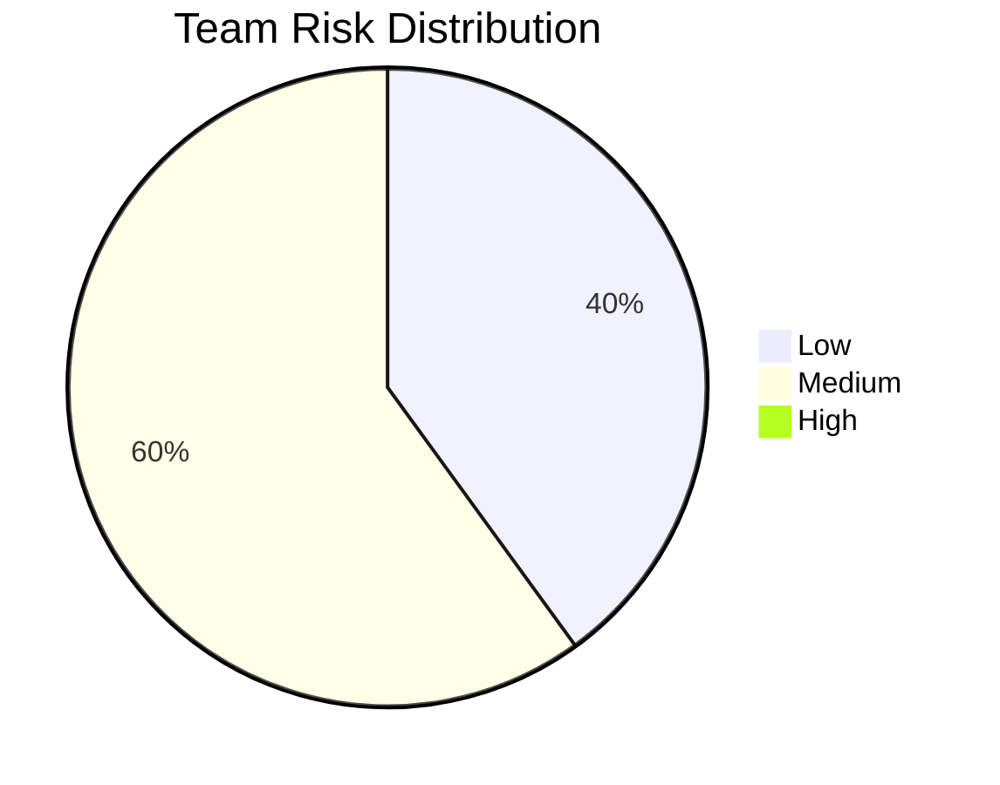
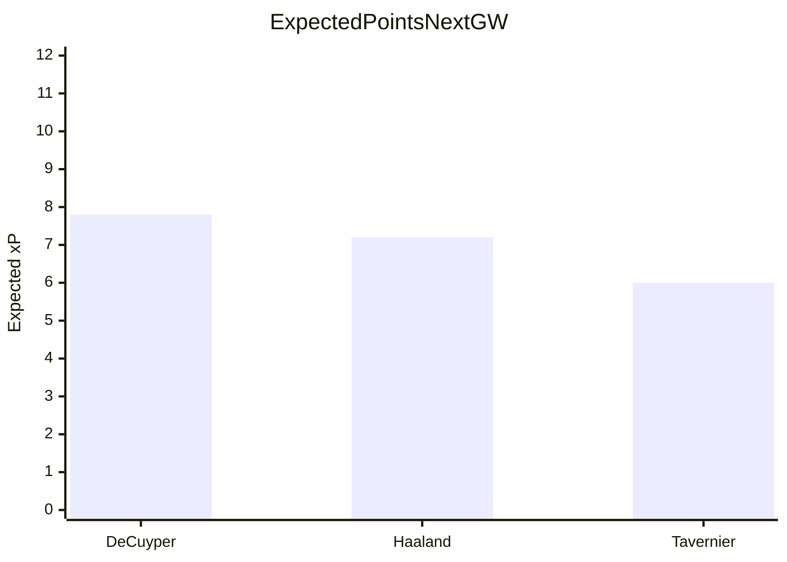
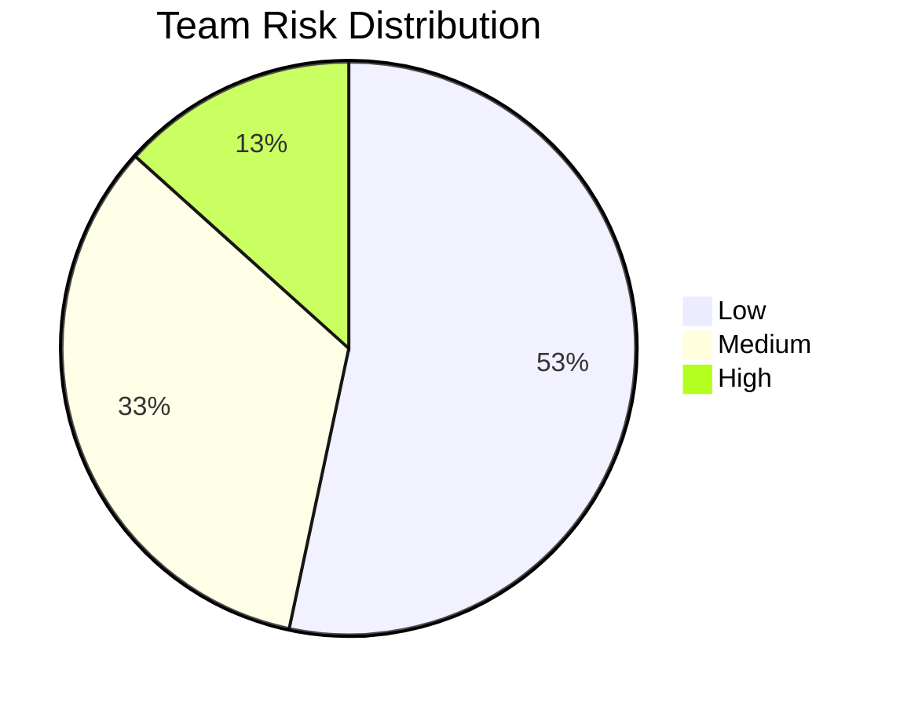
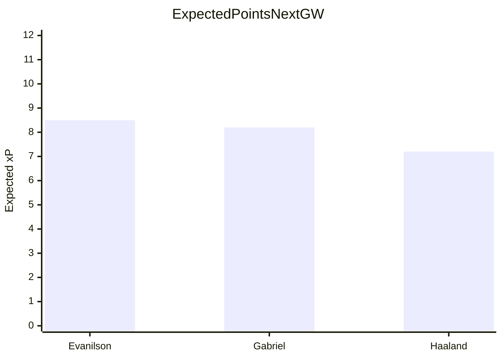
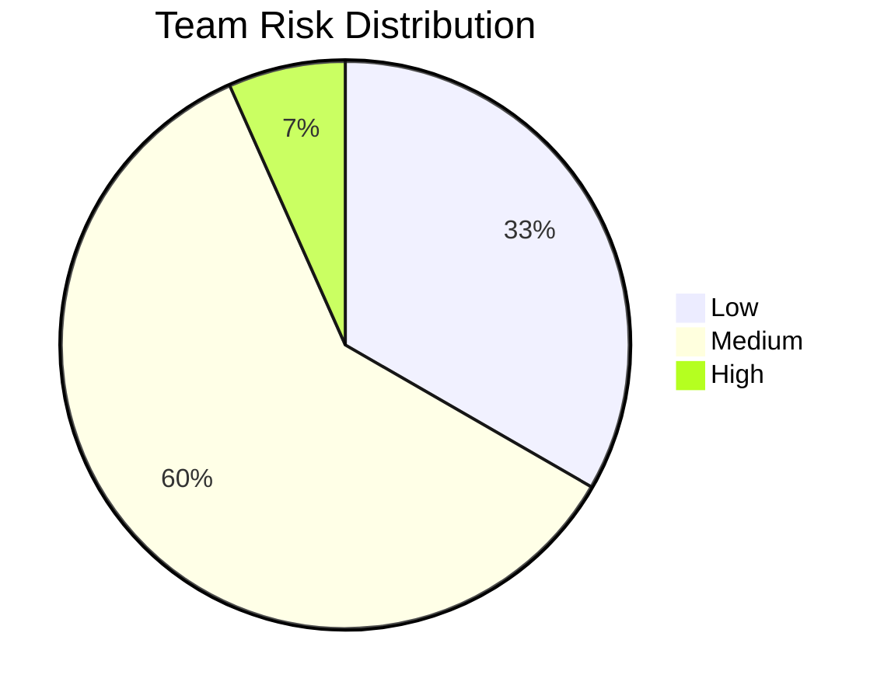

# FPL WEEKLY ANALYSIS REPORT
Generated: 2026-11-06 16:31:38

## Team Overview
| Team | Team ID | Value | Bank | Free transfers | Transfers used | Captain pick |
|------|---------|-------|------|----------------|----------------|--------------|
| Suresh's Invincibles | 7100718 | 100.0m | 1.2m | 0 | 3 | De Cuyper |
| Frogs FC | 7194103 | 100.3m | 0.5m | 0 | 1 | Evanilson |
| ro$a parks the buss | 8176746 | 101.5m | 3.1m | 1 | 0 | Haaland |

---

# FPL WEEKLY ANALYSIS REPORT - Suresh's Invincibles
Generated: 2026-11-06 16:31:36
Manager: Suresh K
Team: Suresh's Invincibles
Team ID: 7100718

## Summary

| Team | Value | Bank | Free transfers | Transfers used | Captain pick |
|------|-------|------|----------------|----------------|--------------|
| Suresh's Invincibles | £100.0m | £1.2m | 0 | 3 | De Cuyper |

## Risk Snapshot



## Captaincy Comparison



## Risk Table

| Player | Pos | Form | xP | FDR | Risk | Cost |
|--------|-----|------|----|-----|------|------|
| Lecomte | GK | 0.0 ░░░░░░░░ | 0.0 | 3.4 | Medium | £4.0m |
| Wissa | FWD | 1.2 ░░░░░░░░ | 1.2 | 3.2 | Medium | £6.0m |
| Mac Allister | MID | 1.8 █░░░░░░░ | 1.8 | 2.8 | Medium | £5.4m |
| Diop | DEF | 2.0 █░░░░░░░ | 2.0 | 2.8 | Medium | £3.9m |
| Dasilva | DEF | 2.2 █░░░░░░░ | 2.2 | 2.6 | Medium | £4.0m |
| Ødegaard | MID | 2.5 ██░░░░░░ | 2.5 | 3.2 | Medium | £6.7m |
| Pickford | GK | 2.8 ██░░░░░░ | 2.8 | 3.0 | Medium | £5.5m |
| Cherki | MID | 2.8 ██░░░░░░ | 2.8 | 3.2 | Medium | £7.9m |

## ⚠️ Players to Consider Transferring Out

### Lecomte (GK) - Fulham - £4.0m
- Poor form (0.0)
- Low expected points (0.0)
- Next 3 fixtures: Newcastle(H, FDR:3), Man City(A, FDR:5), Bournemouth(H, FDR:3)
- Free transfers available: 0
- Suggested move: Lecomte OUT -> Verbruggen IN
- Net cost: £0.6m
- Transfer hit if no free transfer: £0.6m
- Value score: 1.52 xP per £m
- Target reason: form 7.0, xP 7.0, fixtures Brentford(H, FDR:3), Hull City(A, FDR:2), Newcastle(H, FDR:3)

| Out | In | Net cost | xP/£m | Notes |
|-----|----|----------|-------|-------|
| Lecomte | Verbruggen | £0.6m | 1.52 | Transfer hit applies |

---

### Wissa (FWD) - Newcastle - £6.0m
- Poor form (1.2)
- Low expected points (1.2)
- Next 3 fixtures: Fulham(A, FDR:3), Arsenal(H, FDR:4), Brighton(A, FDR:4)
- Free transfers available: 0
- Suggested move: Wissa OUT -> Evanilson IN
- Net cost: £0.4m
- Transfer hit if no free transfer: £0.4m
- Value score: 1.33 xP per £m
- Target reason: form 8.5, xP 8.5, fixtures Ipswich Town(A, FDR:2), Nott'm Forest(H, FDR:3), Fulham(A, FDR:3)

| Out | In | Net cost | xP/£m | Notes |
|-----|----|----------|-------|-------|
| Wissa | Evanilson | £0.4m | 1.33 | Transfer hit applies |

---

### Mac Allister (MID) - Liverpool - £5.4m
- Poor form (1.8)
- Low expected points (1.8)
- Next 3 fixtures: Crystal Palace(A, FDR:2), Man Utd(H, FDR:3), Everton(A, FDR:3)
- Free transfers available: 0
- Suggested move: Mac Allister OUT -> Ayari IN
- Net cost: £0.0m
- Transfer hit if no free transfer: £0.0m
- Value score: 1.30 xP per £m
- Target reason: form 7.0, xP 7.0, fixtures Brentford(H, FDR:3), Hull City(A, FDR:2), Newcastle(H, FDR:3)

| Out | In | Net cost | xP/£m | Notes |
|-----|----|----------|-------|-------|
| Mac Allister | Ayari | £0.0m | 1.30 | Transfer hit applies |

---

### Diop (DEF) - Ipswich Town - £3.9m
- Poor form (2.0)
- Next 3 fixtures: Bournemouth(H, FDR:3), Spurs(A, FDR:3), Aston Villa(H, FDR:3)
- Free transfers available: 0
- Suggested move: Diop OUT -> Konsa IN
- Net cost: £0.9m
- Transfer hit if no free transfer: £0.9m
- Value score: 1.92 xP per £m
- Target reason: form 9.2, xP 9.2, fixtures Hull City(H, FDR:2), Newcastle(A, FDR:3), Man City(H, FDR:4)

| Out | In | Net cost | xP/£m | Notes |
|-----|----|----------|-------|-------|
| Diop | Konsa | £0.9m | 1.92 | Transfer hit applies |

---

### Dasilva (DEF) - Coventry City - £4.0m
- Poor form (2.2)
- Next 3 fixtures: Everton(A, FDR:3), Crystal Palace(H, FDR:2), Leeds(A, FDR:3)
- Free transfers available: 0
- Suggested move: Dasilva OUT -> Konsa IN
- Net cost: £0.8m
- Transfer hit if no free transfer: £0.8m
- Value score: 1.92 xP per £m
- Target reason: form 9.2, xP 9.2, fixtures Hull City(H, FDR:2), Newcastle(A, FDR:3), Man City(H, FDR:4)

| Out | In | Net cost | xP/£m | Notes |
|-----|----|----------|-------|-------|
| Dasilva | Konsa | £0.8m | 1.92 | Transfer hit applies |

---

## 🌟 Top Performers

| Player | Pos | Team | Form | xP | Fixtures |
|--------|-----|------|------|----|----------|
| De Cuyper | DEF | Brighton | 7.8 | 7.8 | Brentford(H, FDR:3), Hull City(A, FDR:2), Newcastle(H, FDR:3) |
| Haaland | FWD | Man City | 7.2 | 7.2 | Nott'm Forest(A, FDR:2), Fulham(H, FDR:2), Arsenal(A, FDR:5) |
| Tavernier | MID | Bournemouth | 6.0 | 6.0 | Ipswich Town(A, FDR:2), Nott'm Forest(H, FDR:3), Fulham(A, FDR:3) |
| Calafiori | DEF | Arsenal | 5.5 | 5.5 | Hull City(H, FDR:2), Newcastle(A, FDR:3), Man City(H, FDR:4) |
| Palmer | MID | Chelsea | 4.2 | 4.2 | Sunderland(A, FDR:3), Leeds(H, FDR:3), Nott'm Forest(A, FDR:2) |

## 👑 Captain Recommendations

1. **De Cuyper** - Expected: 7.8 points | Next fixture: Brentford
2. **Haaland** - Expected: 7.2 points | Next fixture: Nott'm Forest
3. **Tavernier** - Expected: 6.0 points | Next fixture: Ipswich Town

## Transfer Strategy

- No free transfers available this GW.
- Favor low-net-cost moves and only do transfers that materially improve xP or fixture difficulty.
- If the net cost is high, make sure the incoming player has stronger expected points and fixtures than the outgoing player.
# FPL WEEKLY ANALYSIS REPORT - Frogs FC
Generated: 2026-11-06 16:31:37
Manager: Sanvika Suresh
Team: Frogs FC
Team ID: 7194103

## Summary

| Team | Value | Bank | Free transfers | Transfers used | Captain pick |
|------|-------|------|----------------|----------------|--------------|
| Frogs FC | £100.3m | £0.5m | 0 | 1 | Evanilson |

## Risk Snapshot



## Captaincy Comparison



## Risk Table

| Player | Pos | Form | xP | FDR | Risk | Cost |
|--------|-----|------|----|-----|------|------|
| Branthwaite | DEF | 3.2 ██░░░░░░ | 2.4 | 3.0 | High | £5.5m |
| Calvert-Lewin | FWD | 3.8 ███░░░░░ | 2.8 | 3.2 | High | £6.1m |
| Penders | GK | 1.8 █░░░░░░░ | 1.8 | 2.8 | Medium | £4.4m |
| Diop | DEF | 2.0 █░░░░░░░ | 2.0 | 2.8 | Medium | £3.9m |
| Gibbs-White | MID | 1.5 █░░░░░░░ | 1.5 | 3.6 | Medium | £7.8m |
| Fernandes | MID | 3.0 ██░░░░░░ | 3.0 | 2.8 | Low | £5.6m |
| Kayode | DEF | 2.5 ██░░░░░░ | 2.5 | 3.6 | Medium | £4.5m |
| Tzolakis | GK | 2.2 █░░░░░░░ | 2.2 | 3.6 | Medium | £4.7m |

## ⚠️ Players to Consider Transferring Out

### Branthwaite (DEF) - Everton - £5.5m
- **INJURED/UNAVAILABLE** - Unspecified injury - 75% chance of playing
- Next 3 fixtures: Coventry City(H, FDR:2), Brentford(A, FDR:4), Liverpool(H, FDR:4)
- Free transfers available: 0
- Suggested move: Branthwaite OUT -> Konsa IN
- Net cost: £-0.7m
- Transfer hit if no free transfer: £0.0m
- Value score: 1.92 xP per £m
- Target reason: form 9.2, xP 9.2, fixtures Hull City(H, FDR:2), Newcastle(A, FDR:3), Man City(H, FDR:4)

| Out | In | Net cost | xP/£m | Notes |
|-----|----|----------|-------|-------|
| Branthwaite | Konsa | £-0.7m | 1.92 | Transfer hit applies |

---

### Calvert-Lewin (FWD) - Leeds - £6.1m
- **INJURED/UNAVAILABLE** - Foot injury - 75% chance of playing
- Next 3 fixtures: Spurs(H, FDR:3), Chelsea(A, FDR:4), Coventry City(H, FDR:2)
- Free transfers available: 0
- Suggested move: Calvert-Lewin OUT -> Evanilson IN
- Net cost: £0.3m
- Transfer hit if no free transfer: £0.3m
- Value score: 1.33 xP per £m
- Target reason: form 8.5, xP 8.5, fixtures Ipswich Town(A, FDR:2), Nott'm Forest(H, FDR:3), Fulham(A, FDR:3)

| Out | In | Net cost | xP/£m | Notes |
|-----|----|----------|-------|-------|
| Calvert-Lewin | Evanilson | £0.3m | 1.33 | Transfer hit applies |

---

### Penders (GK) - Chelsea - £4.4m
- Poor form (1.8)
- Low expected points (1.8)
- Next 3 fixtures: Sunderland(A, FDR:3), Leeds(H, FDR:3), Nott'm Forest(A, FDR:2)
- Free transfers available: 0
- Suggested move: Penders OUT -> Verbruggen IN
- Net cost: £0.2m
- Transfer hit if no free transfer: £0.2m
- Value score: 1.52 xP per £m
- Target reason: form 7.0, xP 7.0, fixtures Brentford(H, FDR:3), Hull City(A, FDR:2), Newcastle(H, FDR:3)

| Out | In | Net cost | xP/£m | Notes |
|-----|----|----------|-------|-------|
| Penders | Verbruggen | £0.2m | 1.52 | Transfer hit applies |

---

### Diop (DEF) - Ipswich Town - £3.9m
- Poor form (2.0)
- Next 3 fixtures: Bournemouth(H, FDR:3), Spurs(A, FDR:3), Aston Villa(H, FDR:3)
- Free transfers available: 0
- Suggested move: Diop OUT -> Robertson IN
- Net cost: £0.4m
- Transfer hit if no free transfer: £0.4m
- Value score: 1.12 xP per £m
- Target reason: form 4.8, xP 4.8, fixtures Leeds(A, FDR:3), Ipswich Town(H, FDR:2), Sunderland(A, FDR:3)

| Out | In | Net cost | xP/£m | Notes |
|-----|----|----------|-------|-------|
| Diop | Robertson | £0.4m | 1.12 | Transfer hit applies |

---

### Gibbs-White (MID) - Nott'm Forest - £7.8m
- Poor form (1.5)
- Difficult fixtures (avg difficulty: 3.6)
- Low expected points (1.5)
- Next 3 fixtures: Man City(H, FDR:4), Bournemouth(A, FDR:4), Chelsea(H, FDR:4)
- Free transfers available: 0
- Suggested move: Gibbs-White OUT -> Ayari IN
- Net cost: £-2.4m
- Transfer hit if no free transfer: £0.0m
- Value score: 1.30 xP per £m
- Target reason: form 7.0, xP 7.0, fixtures Brentford(H, FDR:3), Hull City(A, FDR:2), Newcastle(H, FDR:3)

| Out | In | Net cost | xP/£m | Notes |
|-----|----|----------|-------|-------|
| Gibbs-White | Ayari | £-2.4m | 1.30 | Transfer hit applies |

---

## 🌟 Top Performers

| Player | Pos | Team | Form | xP | Fixtures |
|--------|-----|------|------|----|----------|
| Evanilson | FWD | Bournemouth | 8.5 | 8.5 | Ipswich Town(A, FDR:2), Nott'm Forest(H, FDR:3), Fulham(A, FDR:3) |
| Gabriel | DEF | Arsenal | 8.2 | 8.2 | Hull City(H, FDR:2), Newcastle(A, FDR:3), Man City(H, FDR:4) |
| Haaland | FWD | Man City | 7.2 | 7.2 | Nott'm Forest(A, FDR:2), Fulham(H, FDR:2), Arsenal(A, FDR:5) |
| Rogers | MID | Chelsea | 5.2 | 5.2 | Sunderland(A, FDR:3), Leeds(H, FDR:3), Nott'm Forest(A, FDR:2) |
| Dewsbury-Hall | MID | Everton | 5.2 | 5.2 | Coventry City(H, FDR:2), Brentford(A, FDR:4), Liverpool(H, FDR:4) |

## 👑 Captain Recommendations

1. **Evanilson** - Expected: 8.5 points | Next fixture: Ipswich Town
2. **Gabriel** - Expected: 8.2 points | Next fixture: Hull City
3. **Haaland** - Expected: 7.2 points | Next fixture: Nott'm Forest

## Transfer Strategy

- No free transfers available this GW.
- Favor low-net-cost moves and only do transfers that materially improve xP or fixture difficulty.
- If the net cost is high, make sure the incoming player has stronger expected points and fixtures than the outgoing player.
# FPL WEEKLY ANALYSIS REPORT - ro$a parks the buss
Generated: 2026-11-06 16:31:38
Manager: Mikhail Leo
Team: ro$a parks the buss
Team ID: 8176746

## Summary

| Team | Value | Bank | Free transfers | Transfers used | Captain pick |
|------|-------|------|----------------|----------------|--------------|
| ro$a parks the buss | £101.5m | £3.1m | 1 | 0 | Haaland |

## Risk Snapshot



## Captaincy Comparison

```mermaid
xychart-beta
    title Expected Points Next GW
    x-axis [Haaland, Silva, Muharemović]
    y-axis "Expected xP" 0 --> 12
    bar [7.2, 6.0, 4.8]
```

## Risk Table

| Player | Pos | Form | xP | FDR | Risk | Cost |
|--------|-----|------|----|-----|------|------|
| Dubravka | GK | 0.0 ░░░░░░░░ | 0.0 | 2.8 | Medium | £4.0m |
| Walle Egeli | FWD | 0.2 ░░░░░░░░ | 0.2 | 2.8 | Medium | £4.5m |
| Szoboszlai | MID | 0.5 ░░░░░░░░ | 0.5 | 2.8 | Medium | £6.7m |
| João Pedro | FWD | 3.5 ██░░░░░░ | 0.0 | 2.8 | High | £7.7m |
| M.Sangaré | MID | 2.2 █░░░░░░░ | 2.2 | 3.6 | Medium | £5.4m |
| Gvardiol | DEF | 1.8 █░░░░░░░ | 1.8 | 3.2 | Medium | £5.7m |
| Egan | DEF | 2.5 ██░░░░░░ | 2.5 | 3.6 | Medium | £4.1m |
| Kelleher | GK | 3.2 ██░░░░░░ | 3.2 | 3.6 | Medium | £5.0m |

## ⚠️ Players to Consider Transferring Out

### Dubravka (GK) - Spurs - £4.0m
- Poor form (0.0)
- Low expected points (0.0)
- Next 3 fixtures: Leeds(A, FDR:3), Ipswich Town(H, FDR:2), Sunderland(A, FDR:3)
- Free transfers available: 1
- Suggested move: Dubravka OUT -> Verbruggen IN
- Net cost: £0.6m
- Transfer hit if no free transfer: £0.0m
- Value score: 1.52 xP per £m
- Target reason: form 7.0, xP 7.0, fixtures Brentford(H, FDR:3), Hull City(A, FDR:2), Newcastle(H, FDR:3)

| Out | In | Net cost | xP/£m | Notes |
|-----|----|----------|-------|-------|
| Dubravka | Verbruggen | £0.6m | 1.52 | Free transfer available |

---

### Walle Egeli (FWD) - Ipswich Town - £4.5m
- Poor form (0.2)
- Low expected points (0.2)
- Next 3 fixtures: Bournemouth(H, FDR:3), Spurs(A, FDR:3), Aston Villa(H, FDR:3)
- Free transfers available: 1
- Suggested move: Walle Egeli OUT -> Evanilson IN
- Net cost: £1.9m
- Transfer hit if no free transfer: £0.0m
- Value score: 1.33 xP per £m
- Target reason: form 8.5, xP 8.5, fixtures Ipswich Town(A, FDR:2), Nott'm Forest(H, FDR:3), Fulham(A, FDR:3)

| Out | In | Net cost | xP/£m | Notes |
|-----|----|----------|-------|-------|
| Walle Egeli | Evanilson | £1.9m | 1.33 | Free transfer available |

---

### Szoboszlai (MID) - Liverpool - £6.7m
- Poor form (0.5)
- Low expected points (0.5)
- Next 3 fixtures: Crystal Palace(A, FDR:2), Man Utd(H, FDR:3), Everton(A, FDR:3)
- Free transfers available: 1
- Suggested move: Szoboszlai OUT -> Ayari IN
- Net cost: £-1.3m
- Transfer hit if no free transfer: £0.0m
- Value score: 1.30 xP per £m
- Target reason: form 7.0, xP 7.0, fixtures Brentford(H, FDR:3), Hull City(A, FDR:2), Newcastle(H, FDR:3)

| Out | In | Net cost | xP/£m | Notes |
|-----|----|----------|-------|-------|
| Szoboszlai | Ayari | £-1.3m | 1.30 | Free transfer available |

---

### João Pedro (FWD) - Chelsea - £7.7m
- **INJURED/UNAVAILABLE** - Thigh injury - Unknown return date
- Low expected points (0.0)
- Next 3 fixtures: Sunderland(A, FDR:3), Leeds(H, FDR:3), Nott'm Forest(A, FDR:2)
- Free transfers available: 1
- Suggested move: João Pedro OUT -> Evanilson IN
- Net cost: £-1.3m
- Transfer hit if no free transfer: £0.0m
- Value score: 1.33 xP per £m
- Target reason: form 8.5, xP 8.5, fixtures Ipswich Town(A, FDR:2), Nott'm Forest(H, FDR:3), Fulham(A, FDR:3)

| Out | In | Net cost | xP/£m | Notes |
|-----|----|----------|-------|-------|
| João Pedro | Evanilson | £-1.3m | 1.33 | Free transfer available |

---

### M.Sangaré (MID) - Brentford - £5.4m
- Poor form (2.2)
- Difficult fixtures (avg difficulty: 3.6)
- Next 3 fixtures: Brighton(A, FDR:4), Everton(H, FDR:3), Man Utd(A, FDR:3)
- Free transfers available: 1
- Suggested move: M.Sangaré OUT -> Ayari IN
- Net cost: £0.0m
- Transfer hit if no free transfer: £0.0m
- Value score: 1.30 xP per £m
- Target reason: form 7.0, xP 7.0, fixtures Brentford(H, FDR:3), Hull City(A, FDR:2), Newcastle(H, FDR:3)

| Out | In | Net cost | xP/£m | Notes |
|-----|----|----------|-------|-------|
| M.Sangaré | Ayari | £0.0m | 1.30 | Free transfer available |

---

## 🌟 Top Performers

| Player | Pos | Team | Form | xP | Fixtures |
|--------|-----|------|------|----|----------|
| Haaland | FWD | Man City | 7.2 | 7.2 | Nott'm Forest(A, FDR:2), Fulham(H, FDR:2), Arsenal(A, FDR:5) |
| Silva | DEF | Bournemouth | 6.0 | 6.0 | Ipswich Town(A, FDR:2), Nott'm Forest(H, FDR:3), Fulham(A, FDR:3) |
| Muharemović | DEF | Leeds | 4.8 | 4.8 | Spurs(H, FDR:3), Chelsea(A, FDR:4), Coventry City(H, FDR:2) |
| Palmer | MID | Chelsea | 4.2 | 4.2 | Sunderland(A, FDR:3), Leeds(H, FDR:3), Nott'm Forest(A, FDR:2) |
| Groß | MID | Brighton | 3.2 | 3.2 | Brentford(H, FDR:3), Hull City(A, FDR:2), Newcastle(H, FDR:3) |

## 👑 Captain Recommendations

1. **Haaland** - Expected: 7.2 points | Next fixture: Nott'm Forest
2. **Silva** - Expected: 6.0 points | Next fixture: Ipswich Town
3. **Muharemović** - Expected: 4.8 points | Next fixture: Spurs

## Best Single Transfer

- OUT: Walle Egeli (FWD)
- IN: Evanilson (FWD)
- Net cost: £1.9m
- Estimated transfer hit: £0.0m
- Value score: 1.33 xP per £m
- Reason: best low-risk, high-value move under your current transfer constraints

## Transfer Strategy

- You have 1 free transfer(s) available this GW.
- Prioritize moves that improve xP without a transfer hit or with a small net cost.
- If a player has poor fixtures or poor form, the best move is often a cheaper, higher-xP alternative in the same position.