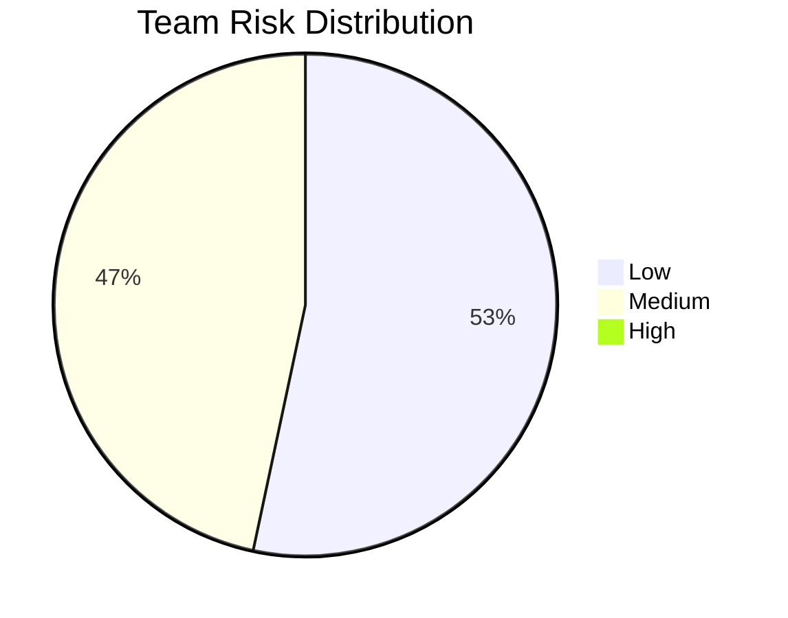
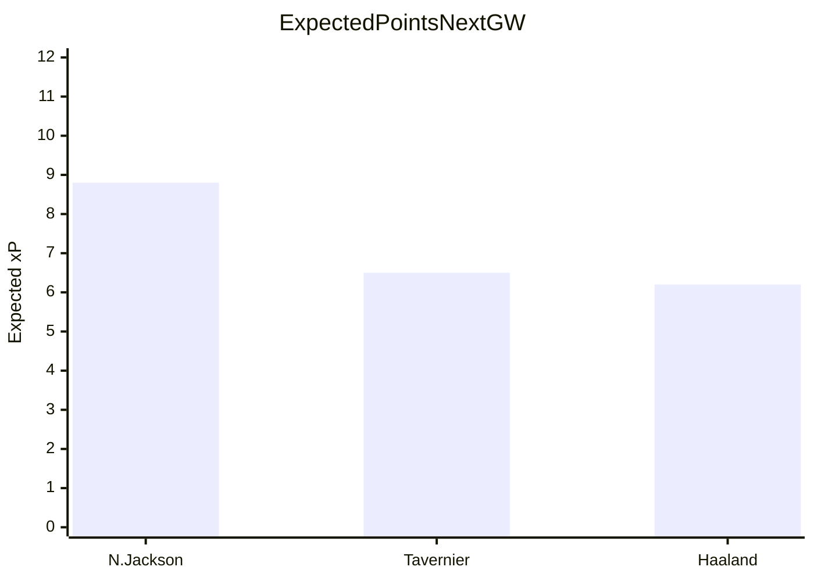
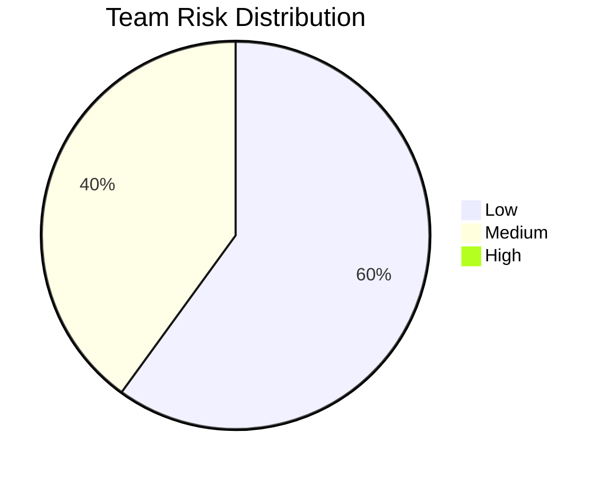
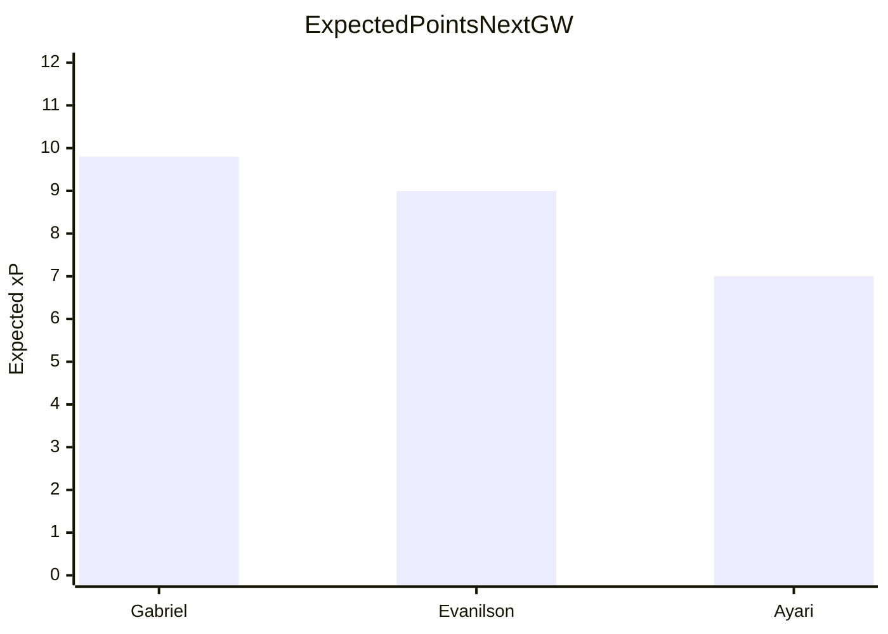
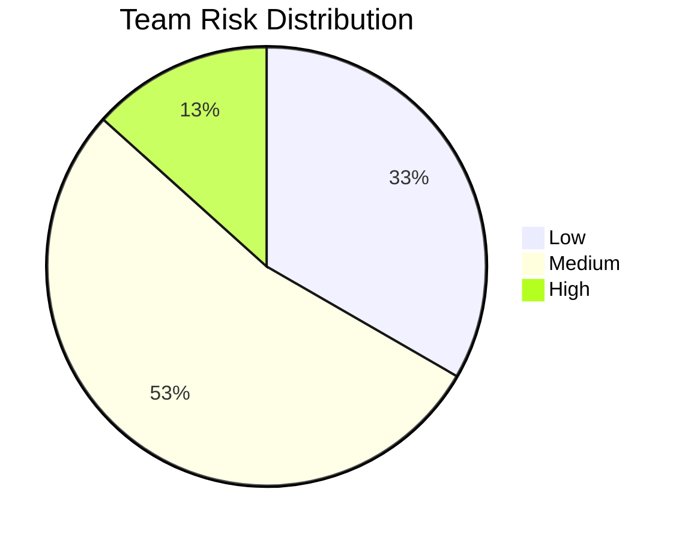

# FPL WEEKLY ANALYSIS REPORT
Generated: 2026-11-13 16:53:07

## Team Overview
| Team | Team ID | Value | Bank | Free transfers | Transfers used | Captain pick |
|------|---------|-------|------|----------------|----------------|--------------|
| Suresh's Invincibles | 7100718 | 100.1m | 0.2m | 0 | 1 | N.Jackson |
| Frogs FC | 7194103 | 100.3m | 0.7m | 0 | 1 | Gabriel |
| ro$a parks the buss | 8176746 | 101.4m | 3.1m | 1 | 0 | Silva |

---

# FPL WEEKLY ANALYSIS REPORT - Suresh's Invincibles
Generated: 2026-11-13 16:53:06
Manager: Suresh K
Team: Suresh's Invincibles
Team ID: 7100718

## Summary

| Team | Value | Bank | Free transfers | Transfers used | Captain pick |
|------|-------|------|----------------|----------------|--------------|
| Suresh's Invincibles | £100.1m | £0.2m | 0 | 1 | N.Jackson |

## Risk Snapshot



## Captaincy Comparison



## Risk Table

| Player | Pos | Form | xP | FDR | Risk | Cost |
|--------|-----|------|----|-----|------|------|
| Lecomte | GK | 0.0 ░░░░░░░░ | 0.0 | 3.4 | Medium | £4.0m |
| Dasilva | DEF | 1.2 ░░░░░░░░ | 1.2 | 2.6 | Medium | £4.0m |
| Diop | DEF | 1.8 █░░░░░░░ | 1.8 | 2.8 | Medium | £3.9m |
| Mac Allister | MID | 3.5 ██░░░░░░ | 3.5 | 3.0 | Low | £5.4m |
| Pickford | GK | 3.2 ██░░░░░░ | 3.2 | 3.4 | Low | £5.5m |
| Palmer | MID | 2.8 ██░░░░░░ | 2.8 | 3.2 | Medium | £9.8m |
| Tarkowski | DEF | 2.5 ██░░░░░░ | 2.5 | 3.4 | Medium | £6.2m |
| Cherki | MID | 2.5 ██░░░░░░ | 2.5 | 3.6 | Medium | £7.9m |

## ⚠️ Players to Consider Transferring Out

### Lecomte (GK) - Fulham - £4.0m
- Poor form (0.0)
- Low expected points (0.0)
- Next 3 fixtures: Man City(A, FDR:5), Bournemouth(H, FDR:3), Spurs(A, FDR:3)
- Free transfers available: 0
- Suggested move: Lecomte OUT -> Gunter IN
- Net cost: £0.0m
- Transfer hit if no free transfer: £0.0m
- Value score: 0.25 xP per £m
- Target reason: form 0.0, xP 1.0, fixtures Ipswich Town(H, FDR:2), Sunderland(A, FDR:3), Fulham(H, FDR:2)

| Out | In | Net cost | xP/£m | Notes |
|-----|----|----------|-------|-------|
| Lecomte | Gunter | £0.0m | 0.25 | Transfer hit applies |

---

### Dasilva (DEF) - Coventry City - £4.0m
- Poor form (1.2)
- Low expected points (1.2)
- Next 3 fixtures: Crystal Palace(H, FDR:2), Leeds(A, FDR:3), Ipswich Town(H, FDR:2)
- Free transfers available: 0
- Suggested move: Dasilva OUT -> O'Nien IN
- Net cost: £-0.1m
- Transfer hit if no free transfer: £0.0m
- Value score: 1.23 xP per £m
- Target reason: form 4.8, xP 4.8, fixtures Aston Villa(A, FDR:3), Spurs(H, FDR:3), Liverpool(A, FDR:4)

| Out | In | Net cost | xP/£m | Notes |
|-----|----|----------|-------|-------|
| Dasilva | O'Nien | £-0.1m | 1.23 | Transfer hit applies |

---

### Diop (DEF) - Ipswich Town - £3.9m
- Poor form (1.8)
- Low expected points (1.8)
- Next 3 fixtures: Spurs(A, FDR:3), Aston Villa(H, FDR:3), Coventry City(A, FDR:2)
- Free transfers available: 0
- Suggested move: Diop OUT -> O'Nien IN
- Net cost: £0.0m
- Transfer hit if no free transfer: £0.0m
- Value score: 1.23 xP per £m
- Target reason: form 4.8, xP 4.8, fixtures Aston Villa(A, FDR:3), Spurs(H, FDR:3), Liverpool(A, FDR:4)

| Out | In | Net cost | xP/£m | Notes |
|-----|----|----------|-------|-------|
| Diop | O'Nien | £0.0m | 1.23 | Transfer hit applies |

---

## 🌟 Top Performers

| Player | Pos | Team | Form | xP | Fixtures |
|--------|-----|------|------|----|----------|
| N.Jackson | FWD | Aston Villa | 8.8 | 8.8 | Sunderland(H, FDR:2), Ipswich Town(A, FDR:2), Everton(H, FDR:3) |
| Haaland | FWD | Man City | 6.2 | 6.2 | Fulham(H, FDR:2), Arsenal(A, FDR:5), Leeds(H, FDR:3) |
| Tavernier | MID | Bournemouth | 6.5 | 6.5 | Nott'm Forest(H, FDR:3), Fulham(A, FDR:3), Brighton(H, FDR:4) |
| De Cuyper | DEF | Brighton | 5.5 | 5.5 | Hull City(A, FDR:2), Newcastle(H, FDR:3), Bournemouth(A, FDR:4) |
| Calafiori | DEF | Arsenal | 4.8 | 4.8 | Newcastle(A, FDR:3), Man City(H, FDR:4), Brentford(A, FDR:4) |

## 👑 Captain Recommendations

1. **N.Jackson** - Expected: 8.8 points | Next fixture: Sunderland
2. **Tavernier** - Expected: 6.5 points | Next fixture: Nott'm Forest
3. **Haaland** - Expected: 6.2 points | Next fixture: Fulham

## Transfer Strategy

- No free transfers available this GW.
- Favor low-net-cost moves and only do transfers that materially improve xP or fixture difficulty.
- If the net cost is high, make sure the incoming player has stronger expected points and fixtures than the outgoing player.
# FPL WEEKLY ANALYSIS REPORT - Frogs FC
Generated: 2026-11-13 16:53:06
Manager: Sanvika Suresh
Team: Frogs FC
Team ID: 7194103

## Summary

| Team | Value | Bank | Free transfers | Transfers used | Captain pick |
|------|-------|------|----------------|----------------|--------------|
| Frogs FC | £100.3m | £0.7m | 0 | 1 | Gabriel |

## Risk Snapshot



## Captaincy Comparison



## Risk Table

| Player | Pos | Form | xP | FDR | Risk | Cost |
|--------|-----|------|----|-----|------|------|
| Diop | DEF | 1.8 █░░░░░░░ | 1.8 | 2.8 | Medium | £3.9m |
| Penders | GK | 2.2 █░░░░░░░ | 2.2 | 3.2 | Medium | £4.4m |
| Gibbs-White | MID | 2.2 █░░░░░░░ | 2.2 | 3.4 | Medium | £7.8m |
| Kayode | DEF | 2.8 ██░░░░░░ | 2.8 | 3.4 | Medium | £4.5m |
| Cunha | MID | 2.2 █░░░░░░░ | 2.2 | 2.8 | Medium | £7.8m |
| Branthwaite | DEF | 3.2 ██░░░░░░ | 3.2 | 3.4 | Low | £5.5m |
| Tzolakis | GK | 3.2 ██░░░░░░ | 3.2 | 3.2 | Low | £4.7m |
| Calvert-Lewin | FWD | 3.8 ███░░░░░ | 3.8 | 3.4 | Low | £6.0m |

## ⚠️ Players to Consider Transferring Out

### Diop (DEF) - Ipswich Town - £3.9m
- Poor form (1.8)
- Low expected points (1.8)
- Next 3 fixtures: Spurs(A, FDR:3), Aston Villa(H, FDR:3), Coventry City(A, FDR:2)
- Free transfers available: 0
- Suggested move: Diop OUT -> Castagne IN
- Net cost: £0.6m
- Transfer hit if no free transfer: £0.6m
- Value score: 1.33 xP per £m
- Target reason: form 6.0, xP 6.0, fixtures Man City(A, FDR:5), Bournemouth(H, FDR:3), Spurs(A, FDR:3)

| Out | In | Net cost | xP/£m | Notes |
|-----|----|----------|-------|-------|
| Diop | Castagne | £0.6m | 1.33 | Transfer hit applies |

---

### Penders (GK) - Chelsea - £4.4m
- Poor form (2.2)
- Next 3 fixtures: Leeds(H, FDR:3), Nott'm Forest(A, FDR:2), Crystal Palace(H, FDR:2)
- Free transfers available: 0
- Suggested move: Penders OUT -> Verbruggen IN
- Net cost: £0.3m
- Transfer hit if no free transfer: £0.3m
- Value score: 1.32 xP per £m
- Target reason: form 6.2, xP 6.2, fixtures Hull City(A, FDR:2), Newcastle(H, FDR:3), Bournemouth(A, FDR:4)

| Out | In | Net cost | xP/£m | Notes |
|-----|----|----------|-------|-------|
| Penders | Verbruggen | £0.3m | 1.32 | Transfer hit applies |

---

### Gibbs-White (MID) - Nott'm Forest - £7.8m
- Poor form (2.2)
- Next 3 fixtures: Bournemouth(A, FDR:4), Chelsea(H, FDR:4), Hull City(A, FDR:2)
- Free transfers available: 0
- Suggested move: Gibbs-White OUT -> Ayari IN
- Net cost: £-2.3m
- Transfer hit if no free transfer: £0.0m
- Value score: 1.27 xP per £m
- Target reason: form 7.0, xP 7.0, fixtures Hull City(A, FDR:2), Newcastle(H, FDR:3), Bournemouth(A, FDR:4)

| Out | In | Net cost | xP/£m | Notes |
|-----|----|----------|-------|-------|
| Gibbs-White | Ayari | £-2.3m | 1.27 | Transfer hit applies |

---

### Kayode (DEF) - Brentford - £4.5m
- Poor form (2.8)
- Next 3 fixtures: Everton(H, FDR:3), Man Utd(A, FDR:3), Arsenal(H, FDR:4)
- Free transfers available: 0
- Suggested move: Kayode OUT -> Konsa IN
- Net cost: £0.3m
- Transfer hit if no free transfer: £0.3m
- Value score: 2.12 xP per £m
- Target reason: form 10.2, xP 10.2, fixtures Newcastle(A, FDR:3), Man City(H, FDR:4), Brentford(A, FDR:4)

| Out | In | Net cost | xP/£m | Notes |
|-----|----|----------|-------|-------|
| Kayode | Konsa | £0.3m | 2.12 | Transfer hit applies |

---

### Cunha (MID) - Man Utd - £7.8m
- Poor form (2.2)
- Next 3 fixtures: Liverpool(A, FDR:4), Brentford(H, FDR:3), Newcastle(A, FDR:3)
- Free transfers available: 0
- Suggested move: Cunha OUT -> Ayari IN
- Net cost: £-2.3m
- Transfer hit if no free transfer: £0.0m
- Value score: 1.27 xP per £m
- Target reason: form 7.0, xP 7.0, fixtures Hull City(A, FDR:2), Newcastle(H, FDR:3), Bournemouth(A, FDR:4)

| Out | In | Net cost | xP/£m | Notes |
|-----|----|----------|-------|-------|
| Cunha | Ayari | £-2.3m | 1.27 | Transfer hit applies |

---

## 🌟 Top Performers

| Player | Pos | Team | Form | xP | Fixtures |
|--------|-----|------|------|----|----------|
| Gabriel | DEF | Arsenal | 9.8 | 9.8 | Newcastle(A, FDR:3), Man City(H, FDR:4), Brentford(A, FDR:4) |
| Evanilson | FWD | Bournemouth | 9.0 | 9.0 | Nott'm Forest(H, FDR:3), Fulham(A, FDR:3), Brighton(H, FDR:4) |
| Haaland | FWD | Man City | 6.2 | 6.2 | Fulham(H, FDR:2), Arsenal(A, FDR:5), Leeds(H, FDR:3) |
| Ayari | MID | Brighton | 7.0 | 7.0 | Hull City(A, FDR:2), Newcastle(H, FDR:3), Bournemouth(A, FDR:4) |
| Castagne | DEF | Fulham | 6.0 | 6.0 | Man City(A, FDR:5), Bournemouth(H, FDR:3), Spurs(A, FDR:3) |

## 👑 Captain Recommendations

1. **Gabriel** - Expected: 9.8 points | Next fixture: Newcastle
2. **Evanilson** - Expected: 9.0 points | Next fixture: Nott'm Forest
3. **Ayari** - Expected: 7.0 points | Next fixture: Hull City

## Transfer Strategy

- No free transfers available this GW.
- Favor low-net-cost moves and only do transfers that materially improve xP or fixture difficulty.
- If the net cost is high, make sure the incoming player has stronger expected points and fixtures than the outgoing player.
# FPL WEEKLY ANALYSIS REPORT - ro$a parks the buss
Generated: 2026-11-13 16:53:07
Manager: Mikhail Leo
Team: ro$a parks the buss
Team ID: 8176746

## Summary

| Team | Value | Bank | Free transfers | Transfers used | Captain pick |
|------|-------|------|----------------|----------------|--------------|
| ro$a parks the buss | £101.4m | £3.1m | 1 | 0 | Silva |

## Risk Snapshot



## Captaincy Comparison

```mermaid
xychart-beta
    title Expected Points Next GW
    x-axis [Silva, Muharemović, Haaland]
    y-axis "Expected xP" 0 --> 12
    bar [6.8, 6.8, 6.2]
```

## Risk Table

| Player | Pos | Form | xP | FDR | Risk | Cost |
|--------|-----|------|----|-----|------|------|
| Dubravka | GK | 0.0 ░░░░░░░░ | 0.0 | 2.6 | Medium | £4.0m |
| Walle Egeli | FWD | 0.0 ░░░░░░░░ | 0.0 | 2.8 | Medium | £4.5m |
| Gvardiol | DEF | 0.8 ░░░░░░░░ | 0.6 | 3.6 | High | £5.6m |
| João Pedro | FWD | 0.5 ░░░░░░░░ | 0.0 | 3.2 | High | £7.6m |
| M.Sangaré | MID | 2.2 █░░░░░░░ | 2.2 | 3.4 | Medium | £5.4m |
| Szoboszlai | MID | 2.2 █░░░░░░░ | 2.2 | 3.0 | Medium | £6.7m |
| Egan | DEF | 2.8 ██░░░░░░ | 2.8 | 3.2 | Medium | £4.1m |
| Kelleher | GK | 3.2 ██░░░░░░ | 3.2 | 3.4 | Low | £5.0m |

## ⚠️ Players to Consider Transferring Out

### Dubravka (GK) - Spurs - £4.0m
- Poor form (0.0)
- Low expected points (0.0)
- Next 3 fixtures: Ipswich Town(H, FDR:2), Sunderland(A, FDR:3), Fulham(H, FDR:2)
- Free transfers available: 1
- Suggested move: Dubravka OUT -> Verbruggen IN
- Net cost: £0.7m
- Transfer hit if no free transfer: £0.0m
- Value score: 1.32 xP per £m
- Target reason: form 6.2, xP 6.2, fixtures Hull City(A, FDR:2), Newcastle(H, FDR:3), Bournemouth(A, FDR:4)

| Out | In | Net cost | xP/£m | Notes |
|-----|----|----------|-------|-------|
| Dubravka | Verbruggen | £0.7m | 1.32 | Free transfer available |

---

### Walle Egeli (FWD) - Ipswich Town - £4.5m
- Poor form (0.0)
- Low expected points (0.0)
- Next 3 fixtures: Spurs(A, FDR:3), Aston Villa(H, FDR:3), Coventry City(A, FDR:2)
- Free transfers available: 1
- Suggested move: Walle Egeli OUT -> Evanilson IN
- Net cost: £2.0m
- Transfer hit if no free transfer: £0.0m
- Value score: 1.38 xP per £m
- Target reason: form 9.0, xP 9.0, fixtures Nott'm Forest(H, FDR:3), Fulham(A, FDR:3), Brighton(H, FDR:4)

| Out | In | Net cost | xP/£m | Notes |
|-----|----|----------|-------|-------|
| Walle Egeli | Evanilson | £2.0m | 1.38 | Free transfer available |

---

### Gvardiol (DEF) - Man City - £5.6m
- **INJURED/UNAVAILABLE** - Unspecified injury - 75% chance of playing
- Poor form (0.8)
- Difficult fixtures (avg difficulty: 3.6)
- Low expected points (0.6)
- Next 3 fixtures: Fulham(H, FDR:2), Arsenal(A, FDR:5), Leeds(H, FDR:3)
- Free transfers available: 1
- Suggested move: Gvardiol OUT -> Konsa IN
- Net cost: £-0.8m
- Transfer hit if no free transfer: £0.0m
- Value score: 2.12 xP per £m
- Target reason: form 10.2, xP 10.2, fixtures Newcastle(A, FDR:3), Man City(H, FDR:4), Brentford(A, FDR:4)

| Out | In | Net cost | xP/£m | Notes |
|-----|----|----------|-------|-------|
| Gvardiol | Konsa | £-0.8m | 2.12 | Free transfer available |

---

### João Pedro (FWD) - Chelsea - £7.6m
- **INJURED/UNAVAILABLE** - Thigh injury - Unknown return date
- Poor form (0.5)
- Low expected points (0.0)
- Next 3 fixtures: Leeds(H, FDR:3), Nott'm Forest(A, FDR:2), Crystal Palace(H, FDR:2)
- Free transfers available: 1
- Suggested move: João Pedro OUT -> Evanilson IN
- Net cost: £-1.1m
- Transfer hit if no free transfer: £0.0m
- Value score: 1.38 xP per £m
- Target reason: form 9.0, xP 9.0, fixtures Nott'm Forest(H, FDR:3), Fulham(A, FDR:3), Brighton(H, FDR:4)

| Out | In | Net cost | xP/£m | Notes |
|-----|----|----------|-------|-------|
| João Pedro | Evanilson | £-1.1m | 1.38 | Free transfer available |

---

### M.Sangaré (MID) - Brentford - £5.4m
- Poor form (2.2)
- Next 3 fixtures: Everton(H, FDR:3), Man Utd(A, FDR:3), Arsenal(H, FDR:4)
- Free transfers available: 1
- Suggested move: M.Sangaré OUT -> Ayari IN
- Net cost: £0.1m
- Transfer hit if no free transfer: £0.0m
- Value score: 1.27 xP per £m
- Target reason: form 7.0, xP 7.0, fixtures Hull City(A, FDR:2), Newcastle(H, FDR:3), Bournemouth(A, FDR:4)

| Out | In | Net cost | xP/£m | Notes |
|-----|----|----------|-------|-------|
| M.Sangaré | Ayari | £0.1m | 1.27 | Free transfer available |

---

## 🌟 Top Performers

| Player | Pos | Team | Form | xP | Fixtures |
|--------|-----|------|------|----|----------|
| Haaland | FWD | Man City | 6.2 | 6.2 | Fulham(H, FDR:2), Arsenal(A, FDR:5), Leeds(H, FDR:3) |
| Muharemović | DEF | Leeds | 6.8 | 6.8 | Chelsea(A, FDR:4), Coventry City(H, FDR:2), Man City(A, FDR:5) |
| Silva | DEF | Bournemouth | 6.8 | 6.8 | Nott'm Forest(H, FDR:3), Fulham(A, FDR:3), Brighton(H, FDR:4) |
| Groß | MID | Brighton | 4.2 | 4.2 | Hull City(A, FDR:2), Newcastle(H, FDR:3), Bournemouth(A, FDR:4) |
| Hall | DEF | Newcastle | 3.8 | 3.8 | Arsenal(H, FDR:4), Brighton(A, FDR:4), Man Utd(H, FDR:3) |

## 👑 Captain Recommendations

1. **Silva** - Expected: 6.8 points | Next fixture: Nott'm Forest
2. **Muharemović** - Expected: 6.8 points | Next fixture: Chelsea
3. **Haaland** - Expected: 6.2 points | Next fixture: Fulham

## Best Single Transfer

- OUT: Gvardiol (DEF)
- IN: Konsa (DEF)
- Net cost: £-0.8m
- Estimated transfer hit: £0.0m
- Value score: 2.12 xP per £m
- Reason: best low-risk, high-value move under your current transfer constraints

## Transfer Strategy

- You have 1 free transfer(s) available this GW.
- Prioritize moves that improve xP without a transfer hit or with a small net cost.
- If a player has poor fixtures or poor form, the best move is often a cheaper, higher-xP alternative in the same position.