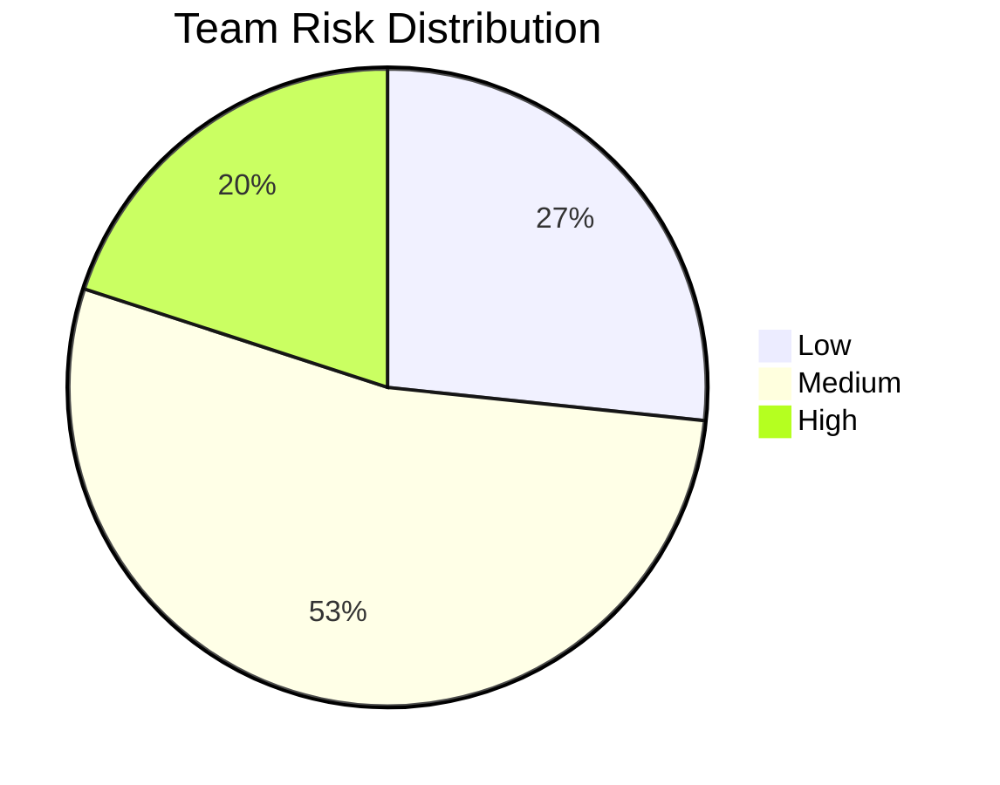
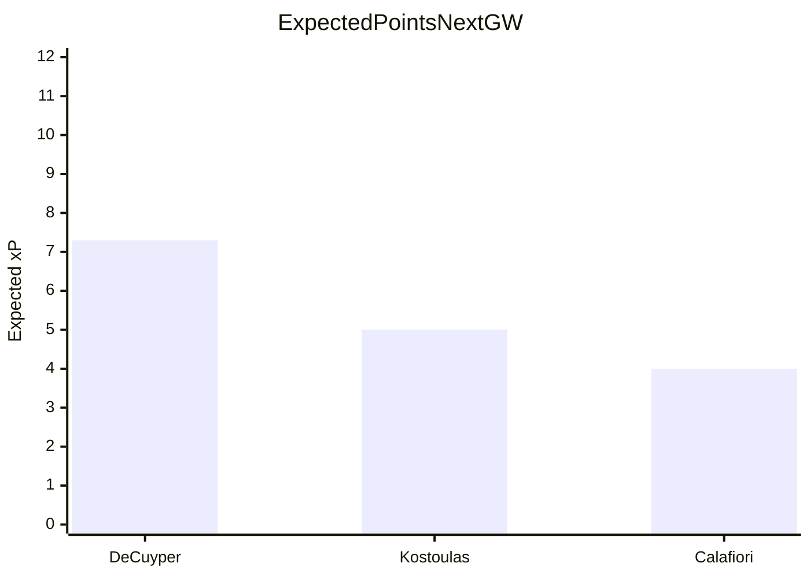
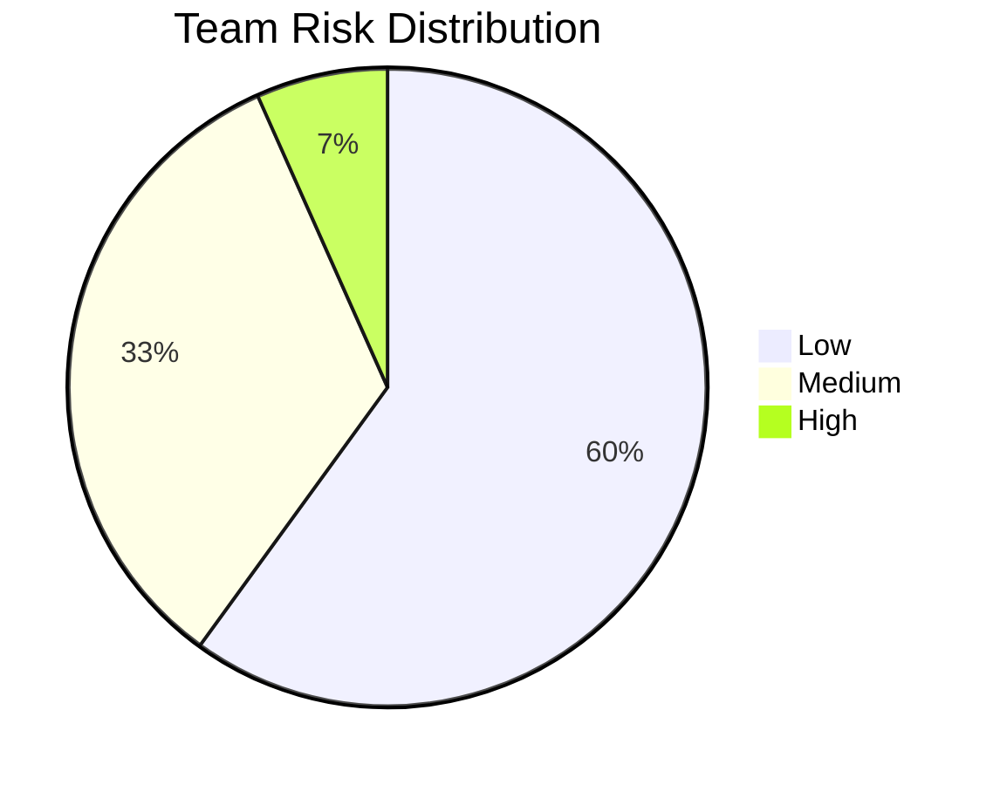
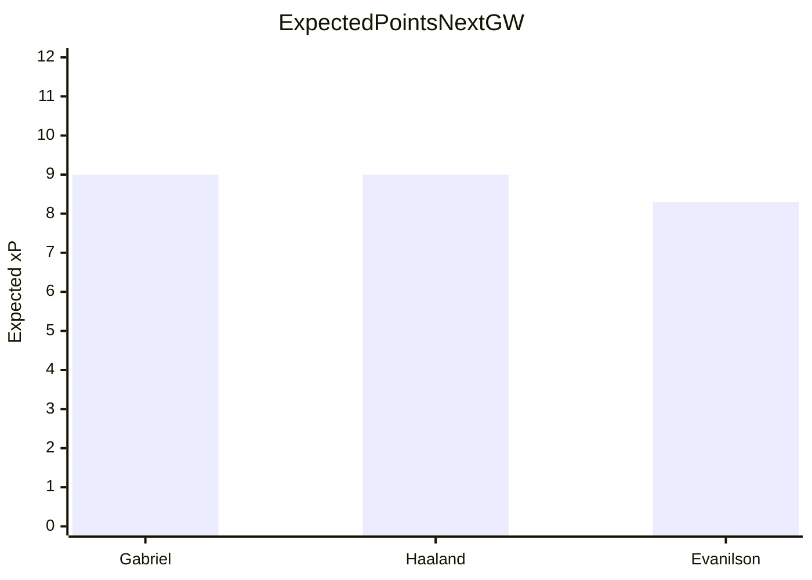
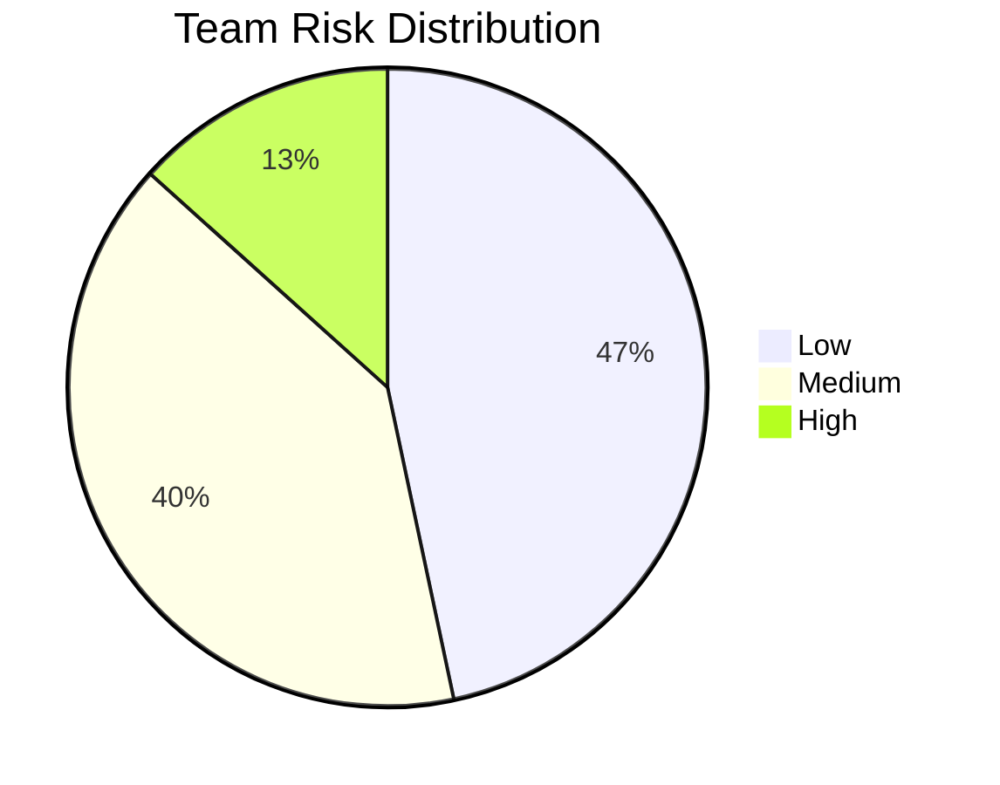

# FPL WEEKLY ANALYSIS REPORT
Generated: 2026-10-30 15:28:16

## Team Overview
| Team | Team ID | Value | Bank | Free transfers | Transfers used | Captain pick |
|------|---------|-------|------|----------------|----------------|--------------|
| Suresh's Invincibles | 7100718 | 100.6m | 1.4m | 0 | 2 | De Cuyper |
| Frogs FC | 7194103 | 100.1m | 0.0m | 1 | 0 | Gabriel |
| ro$a parks the buss | 8176746 | 101.7m | 3.1m | 1 | 0 | Haaland |

---

# FPL WEEKLY ANALYSIS REPORT - Suresh's Invincibles
Generated: 2026-10-30 15:28:15
Manager: Suresh K
Team: Suresh's Invincibles
Team ID: 7100718

## Summary

| Team | Value | Bank | Free transfers | Transfers used | Captain pick |
|------|-------|------|----------------|----------------|--------------|
| Suresh's Invincibles | £100.6m | £1.4m | 0 | 2 | De Cuyper |

## Risk Snapshot



## Captaincy Comparison



## Risk Table

| Player | Pos | Form | xP | FDR | Risk | Cost |
|--------|-----|------|----|-----|------|------|
| Lecomte | GK | 0.0 ░░░░░░░░ | 0.0 | 3.4 | Medium | £4.0m |
| Saka | MID | 1.7 █░░░░░░░ | 0.0 | 3.2 | High | £9.5m |
| Wissa | FWD | 1.3 █░░░░░░░ | 1.3 | 3.6 | Medium | £6.0m |
| Mac Allister | MID | 2.0 █░░░░░░░ | 2.0 | 3.4 | Medium | £5.4m |
| B.Fernandes | MID | 0.7 ░░░░░░░░ | 0.7 | 3.4 | Medium | £11.7m |
| Pickford | GK | 1.3 █░░░░░░░ | 1.3 | 3.0 | Medium | £5.5m |
| Diop | DEF | 2.0 █░░░░░░░ | 2.0 | 2.6 | Medium | £3.9m |
| João Pedro | FWD | 4.7 ███░░░░░ | 0.0 | 3.0 | High | £7.8m |

## ⚠️ Players to Consider Transferring Out

### Lecomte (GK) - Fulham - £4.0m
- Poor form (0.0)
- Low expected points (0.0)
- Next 3 fixtures: Aston Villa(A, FDR:3), Newcastle(H, FDR:3), Man City(A, FDR:5)
- Free transfers available: 0
- Suggested move: Lecomte OUT -> Verbruggen IN
- Net cost: £0.6m
- Transfer hit if no free transfer: £0.6m
- Value score: 1.24 xP per £m
- Target reason: form 5.7, xP 5.7, fixtures Man City(A, FDR:5), Brentford(H, FDR:3), Hull City(A, FDR:2)

| Out | In | Net cost | xP/£m | Notes |
|-----|----|----------|-------|-------|
| Lecomte | Verbruggen | £0.6m | 1.24 | Transfer hit applies |

---

### Saka (MID) - Arsenal - £9.5m
- **INJURED/UNAVAILABLE** - Thigh injury - Unknown return date
- Poor form (1.7)
- Low expected points (0.0)
- Next 3 fixtures: Liverpool(A, FDR:4), Hull City(H, FDR:2), Newcastle(A, FDR:3)
- Free transfers available: 0
- Suggested move: Saka OUT -> Henderson IN
- Net cost: £-4.6m
- Transfer hit if no free transfer: £0.0m
- Value score: 1.57 xP per £m
- Target reason: form 7.7, xP 7.7, fixtures Man Utd(H, FDR:4), Sunderland(A, FDR:3), Leeds(H, FDR:3)

| Out | In | Net cost | xP/£m | Notes |
|-----|----|----------|-------|-------|
| Saka | Henderson | £-4.6m | 1.57 | Transfer hit applies |

---

### Wissa (FWD) - Newcastle - £6.0m
- Poor form (1.3)
- Difficult fixtures (avg difficulty: 3.6)
- Low expected points (1.3)
- Next 3 fixtures: Everton(H, FDR:3), Fulham(A, FDR:3), Arsenal(H, FDR:4)
- Free transfers available: 0
- Suggested move: Wissa OUT -> Evanilson IN
- Net cost: £0.3m
- Transfer hit if no free transfer: £0.3m
- Value score: 1.32 xP per £m
- Target reason: form 8.3, xP 8.3, fixtures Leeds(H, FDR:3), Ipswich Town(A, FDR:2), Nott'm Forest(H, FDR:3)

| Out | In | Net cost | xP/£m | Notes |
|-----|----|----------|-------|-------|
| Wissa | Evanilson | £0.3m | 1.32 | Transfer hit applies |

---

### Mac Allister (MID) - Liverpool - £5.4m
- Poor form (2.0)
- Next 3 fixtures: Arsenal(H, FDR:4), Crystal Palace(A, FDR:3), Man Utd(H, FDR:4)
- Free transfers available: 0
- Suggested move: Mac Allister OUT -> Henderson IN
- Net cost: £-0.5m
- Transfer hit if no free transfer: £0.0m
- Value score: 1.57 xP per £m
- Target reason: form 7.7, xP 7.7, fixtures Man Utd(H, FDR:4), Sunderland(A, FDR:3), Leeds(H, FDR:3)

| Out | In | Net cost | xP/£m | Notes |
|-----|----|----------|-------|-------|
| Mac Allister | Henderson | £-0.5m | 1.57 | Transfer hit applies |

---

### B.Fernandes (MID) - Man Utd - £11.7m
- Poor form (0.7)
- Low expected points (0.7)
- Next 3 fixtures: Chelsea(A, FDR:4), Aston Villa(H, FDR:3), Liverpool(A, FDR:4)
- Free transfers available: 0
- Suggested move: B.Fernandes OUT -> Henderson IN
- Net cost: £-6.8m
- Transfer hit if no free transfer: £0.0m
- Value score: 1.57 xP per £m
- Target reason: form 7.7, xP 7.7, fixtures Man Utd(H, FDR:4), Sunderland(A, FDR:3), Leeds(H, FDR:3)

| Out | In | Net cost | xP/£m | Notes |
|-----|----|----------|-------|-------|
| B.Fernandes | Henderson | £-6.8m | 1.57 | Transfer hit applies |

---

## 🌟 Top Performers

| Player | Pos | Team | Form | xP | Fixtures |
|--------|-----|------|------|----|----------|
| De Cuyper | DEF | Brighton | 7.3 | 7.3 | Man City(A, FDR:5), Brentford(H, FDR:3), Hull City(A, FDR:2) |
| Kostoulas | FWD | Brighton | 5.0 | 5.0 | Man City(A, FDR:5), Brentford(H, FDR:3), Hull City(A, FDR:2) |
| Cherki | MID | Man City | 3.3 | 3.3 | Brighton(H, FDR:3), Nott'm Forest(A, FDR:3), Fulham(H, FDR:2) |
| Palmer | MID | Chelsea | 3.0 | 3.0 | Man Utd(H, FDR:4), Sunderland(A, FDR:3), Leeds(H, FDR:3) |
| Tarkowski | DEF | Everton | 1.7 | 1.7 | Newcastle(A, FDR:3), Coventry City(H, FDR:2), Brentford(A, FDR:3) |

## 👑 Captain Recommendations

1. **De Cuyper** - Expected: 7.3 points | Next fixture: Man City
2. **Kostoulas** - Expected: 5.0 points | Next fixture: Man City
3. **Calafiori** - Expected: 4.0 points | Next fixture: Liverpool

## Transfer Strategy

- No free transfers available this GW.
- Favor low-net-cost moves and only do transfers that materially improve xP or fixture difficulty.
- If the net cost is high, make sure the incoming player has stronger expected points and fixtures than the outgoing player.
# FPL WEEKLY ANALYSIS REPORT - Frogs FC
Generated: 2026-10-30 15:28:16
Manager: Sanvika Suresh
Team: Frogs FC
Team ID: 7194103

## Summary

| Team | Value | Bank | Free transfers | Transfers used | Captain pick |
|------|-------|------|----------------|----------------|--------------|
| Frogs FC | £100.1m | £0.0m | 1 | 0 | Gabriel |

## Risk Snapshot



## Captaincy Comparison



## Risk Table

| Player | Pos | Form | xP | FDR | Risk | Cost |
|--------|-----|------|----|-----|------|------|
| Martinez | GK | 3.7 ██░░░░░░ | 0.0 | 3.0 | High | £5.0m |
| Diop | DEF | 2.0 █░░░░░░░ | 2.0 | 2.6 | Medium | £3.9m |
| Kayode | DEF | 1.7 █░░░░░░░ | 1.7 | 3.6 | Medium | £4.6m |
| Branthwaite | DEF | 1.3 █░░░░░░░ | 1.3 | 3.0 | Medium | £5.5m |
| Gibbs-White | MID | 1.3 █░░░░░░░ | 1.3 | 3.2 | Medium | £7.9m |
| Fernandes | MID | 3.0 ██░░░░░░ | 3.0 | 2.4 | Low | £5.6m |
| Tzolakis | GK | 2.7 ██░░░░░░ | 2.7 | 3.2 | Medium | £4.7m |
| Cunha | MID | 4.0 ███░░░░░ | 4.0 | 3.4 | Low | £7.8m |

## ⚠️ Players to Consider Transferring Out

### Martinez (GK) - Chelsea - £5.0m
- **INJURED/UNAVAILABLE** - Head injury - Unknown return date
- Low expected points (0.0)
- Next 3 fixtures: Man Utd(H, FDR:4), Sunderland(A, FDR:3), Leeds(H, FDR:3)
- Free transfers available: 1
- Suggested move: Martinez OUT -> Verbruggen IN
- Net cost: £-0.4m
- Transfer hit if no free transfer: £0.0m
- Value score: 1.24 xP per £m
- Target reason: form 5.7, xP 5.7, fixtures Man City(A, FDR:5), Brentford(H, FDR:3), Hull City(A, FDR:2)

| Out | In | Net cost | xP/£m | Notes |
|-----|----|----------|-------|-------|
| Martinez | Verbruggen | £-0.4m | 1.24 | Free transfer available |

---

### Diop (DEF) - Ipswich Town - £3.9m
- Poor form (2.0)
- Next 3 fixtures: Hull City(A, FDR:2), Bournemouth(H, FDR:3), Spurs(A, FDR:3)
- Free transfers available: 1
- Suggested move: Diop OUT -> O'Nien IN
- Net cost: £0.0m
- Transfer hit if no free transfer: £0.0m
- Value score: 0.85 xP per £m
- Target reason: form 3.3, xP 3.3, fixtures Coventry City(A, FDR:2), Chelsea(H, FDR:4), Aston Villa(A, FDR:3)

| Out | In | Net cost | xP/£m | Notes |
|-----|----|----------|-------|-------|
| Diop | O'Nien | £0.0m | 0.85 | Free transfer available |

---

### Kayode (DEF) - Brentford - £4.6m
- Poor form (1.7)
- Difficult fixtures (avg difficulty: 3.6)
- Low expected points (1.7)
- Next 3 fixtures: Nott'm Forest(H, FDR:3), Brighton(A, FDR:4), Everton(H, FDR:3)
- Free transfers available: 1
- Suggested move: Kayode OUT -> Bassey IN
- Net cost: £-0.1m
- Transfer hit if no free transfer: £0.0m
- Value score: 1.33 xP per £m
- Target reason: form 6.0, xP 6.0, fixtures Aston Villa(A, FDR:3), Newcastle(H, FDR:3), Man City(A, FDR:5)

| Out | In | Net cost | xP/£m | Notes |
|-----|----|----------|-------|-------|
| Kayode | Bassey | £-0.1m | 1.33 | Free transfer available |

---

### Branthwaite (DEF) - Everton - £5.5m
- Poor form (1.3)
- Low expected points (1.3)
- Next 3 fixtures: Newcastle(A, FDR:3), Coventry City(H, FDR:2), Brentford(A, FDR:3)
- Free transfers available: 1
- Suggested move: Branthwaite OUT -> Konsa IN
- Net cost: £-0.8m
- Transfer hit if no free transfer: £0.0m
- Value score: 1.91 xP per £m
- Target reason: form 9.0, xP 9.0, fixtures Liverpool(A, FDR:4), Hull City(H, FDR:2), Newcastle(A, FDR:3)

| Out | In | Net cost | xP/£m | Notes |
|-----|----|----------|-------|-------|
| Branthwaite | Konsa | £-0.8m | 1.91 | Free transfer available |

---

### Gibbs-White (MID) - Nott'm Forest - £7.9m
- Poor form (1.3)
- Low expected points (1.3)
- Next 3 fixtures: Brentford(A, FDR:3), Man City(H, FDR:4), Bournemouth(A, FDR:3)
- Free transfers available: 1
- Suggested move: Gibbs-White OUT -> Henderson IN
- Net cost: £-3.0m
- Transfer hit if no free transfer: £0.0m
- Value score: 1.57 xP per £m
- Target reason: form 7.7, xP 7.7, fixtures Man Utd(H, FDR:4), Sunderland(A, FDR:3), Leeds(H, FDR:3)

| Out | In | Net cost | xP/£m | Notes |
|-----|----|----------|-------|-------|
| Gibbs-White | Henderson | £-3.0m | 1.57 | Free transfer available |

---

## 🌟 Top Performers

| Player | Pos | Team | Form | xP | Fixtures |
|--------|-----|------|------|----|----------|
| Haaland | FWD | Man City | 9.0 | 9.0 | Brighton(H, FDR:3), Nott'm Forest(A, FDR:3), Fulham(H, FDR:2) |
| Gabriel | DEF | Arsenal | 9.0 | 9.0 | Liverpool(A, FDR:4), Hull City(H, FDR:2), Newcastle(A, FDR:3) |
| Evanilson | FWD | Bournemouth | 8.3 | 8.3 | Leeds(H, FDR:3), Ipswich Town(A, FDR:2), Nott'm Forest(H, FDR:3) |
| Dewsbury-Hall | MID | Everton | 5.7 | 5.7 | Newcastle(A, FDR:3), Coventry City(H, FDR:2), Brentford(A, FDR:3) |
| Castagne | DEF | Fulham | 5.0 | 5.0 | Aston Villa(A, FDR:3), Newcastle(H, FDR:3), Man City(A, FDR:5) |

## 👑 Captain Recommendations

1. **Gabriel** - Expected: 9.0 points | Next fixture: Liverpool
2. **Haaland** - Expected: 9.0 points | Next fixture: Brighton
3. **Evanilson** - Expected: 8.3 points | Next fixture: Leeds

## Best Single Transfer

- OUT: Branthwaite (DEF)
- IN: Konsa (DEF)
- Net cost: £-0.8m
- Estimated transfer hit: £0.0m
- Value score: 1.91 xP per £m
- Reason: best low-risk, high-value move under your current transfer constraints

## Transfer Strategy

- You have 1 free transfer(s) available this GW.
- Prioritize moves that improve xP without a transfer hit or with a small net cost.
- If a player has poor fixtures or poor form, the best move is often a cheaper, higher-xP alternative in the same position.
# FPL WEEKLY ANALYSIS REPORT - ro$a parks the buss
Generated: 2026-10-30 15:28:16
Manager: Mikhail Leo
Team: ro$a parks the buss
Team ID: 8176746

## Summary

| Team | Value | Bank | Free transfers | Transfers used | Captain pick |
|------|-------|------|----------------|----------------|--------------|
| ro$a parks the buss | £101.7m | £3.1m | 1 | 0 | Haaland |

## Risk Snapshot



## Captaincy Comparison

```mermaid
xychart-beta
    title Expected Points Next GW
    x-axis [Haaland, Silva, Muharemović]
    y-axis "Expected xP" 0 --> 12
    bar [9.0, 5.3, 5.3]
```

## Risk Table

| Player | Pos | Form | xP | FDR | Risk | Cost |
|--------|-----|------|----|-----|------|------|
| Dubravka | GK | 0.0 ░░░░░░░░ | 0.0 | 2.4 | Medium | £4.0m |
| Szoboszlai | MID | 0.3 ░░░░░░░░ | 0.1 | 3.4 | High | £6.7m |
| Walle Egeli | FWD | 0.3 ░░░░░░░░ | 0.3 | 2.6 | Medium | £4.5m |
| João Pedro | FWD | 4.7 ███░░░░░ | 0.0 | 3.0 | High | £7.8m |
| Kelleher | GK | 2.0 █░░░░░░░ | 2.0 | 3.6 | Medium | £5.0m |
| M.Sangaré | MID | 2.0 █░░░░░░░ | 2.0 | 3.6 | Medium | £5.4m |
| Gvardiol | DEF | 1.7 █░░░░░░░ | 1.7 | 3.2 | Medium | £5.7m |
| Egan | DEF | 3.0 ██░░░░░░ | 3.0 | 3.2 | Low | £4.1m |

## ⚠️ Players to Consider Transferring Out

### Dubravka (GK) - Spurs - £4.0m
- Poor form (0.0)
- Low expected points (0.0)
- Next 3 fixtures: Crystal Palace(H, FDR:2), Leeds(A, FDR:3), Ipswich Town(H, FDR:2)
- Free transfers available: 1
- Suggested move: Dubravka OUT -> Raya IN
- Net cost: £2.2m
- Transfer hit if no free transfer: £0.0m
- Value score: 1.02 xP per £m
- Target reason: form 6.3, xP 6.3, fixtures Liverpool(A, FDR:4), Hull City(H, FDR:2), Newcastle(A, FDR:3)

| Out | In | Net cost | xP/£m | Notes |
|-----|----|----------|-------|-------|
| Dubravka | Raya | £2.2m | 1.02 | Free transfer available |

---

### Szoboszlai (MID) - Liverpool - £6.7m
- **INJURED/UNAVAILABLE** - Hamstring injury - 50% chance of playing
- Doubt for next match (50% chance)
- Poor form (0.3)
- Low expected points (0.1)
- Next 3 fixtures: Arsenal(H, FDR:4), Crystal Palace(A, FDR:3), Man Utd(H, FDR:4)
- Free transfers available: 1
- Suggested move: Szoboszlai OUT -> Henderson IN
- Net cost: £-1.8m
- Transfer hit if no free transfer: £0.0m
- Value score: 1.57 xP per £m
- Target reason: form 7.7, xP 7.7, fixtures Man Utd(H, FDR:4), Sunderland(A, FDR:3), Leeds(H, FDR:3)

| Out | In | Net cost | xP/£m | Notes |
|-----|----|----------|-------|-------|
| Szoboszlai | Henderson | £-1.8m | 1.57 | Free transfer available |

---

### Walle Egeli (FWD) - Ipswich Town - £4.5m
- Poor form (0.3)
- Low expected points (0.3)
- Next 3 fixtures: Hull City(A, FDR:2), Bournemouth(H, FDR:3), Spurs(A, FDR:3)
- Free transfers available: 1
- Suggested move: Walle Egeli OUT -> Evanilson IN
- Net cost: £1.8m
- Transfer hit if no free transfer: £0.0m
- Value score: 1.32 xP per £m
- Target reason: form 8.3, xP 8.3, fixtures Leeds(H, FDR:3), Ipswich Town(A, FDR:2), Nott'm Forest(H, FDR:3)

| Out | In | Net cost | xP/£m | Notes |
|-----|----|----------|-------|-------|
| Walle Egeli | Evanilson | £1.8m | 1.32 | Free transfer available |

---

### João Pedro (FWD) - Chelsea - £7.8m
- **INJURED/UNAVAILABLE** - Thigh injury - Unknown return date
- Low expected points (0.0)
- Next 3 fixtures: Man Utd(H, FDR:4), Sunderland(A, FDR:3), Leeds(H, FDR:3)
- Free transfers available: 1
- Suggested move: João Pedro OUT -> Evanilson IN
- Net cost: £-1.5m
- Transfer hit if no free transfer: £0.0m
- Value score: 1.32 xP per £m
- Target reason: form 8.3, xP 8.3, fixtures Leeds(H, FDR:3), Ipswich Town(A, FDR:2), Nott'm Forest(H, FDR:3)

| Out | In | Net cost | xP/£m | Notes |
|-----|----|----------|-------|-------|
| João Pedro | Evanilson | £-1.5m | 1.32 | Free transfer available |

---

### Kelleher (GK) - Brentford - £5.0m
- Poor form (2.0)
- Difficult fixtures (avg difficulty: 3.6)
- Next 3 fixtures: Nott'm Forest(H, FDR:3), Brighton(A, FDR:4), Everton(H, FDR:3)
- Free transfers available: 1
- Suggested move: Kelleher OUT -> Raya IN
- Net cost: £1.2m
- Transfer hit if no free transfer: £0.0m
- Value score: 1.02 xP per £m
- Target reason: form 6.3, xP 6.3, fixtures Liverpool(A, FDR:4), Hull City(H, FDR:2), Newcastle(A, FDR:3)

| Out | In | Net cost | xP/£m | Notes |
|-----|----|----------|-------|-------|
| Kelleher | Raya | £1.2m | 1.02 | Free transfer available |

---

## 🌟 Top Performers

| Player | Pos | Team | Form | xP | Fixtures |
|--------|-----|------|------|----|----------|
| Haaland | FWD | Man City | 9.0 | 9.0 | Brighton(H, FDR:3), Nott'm Forest(A, FDR:3), Fulham(H, FDR:2) |
| Muharemović | DEF | Leeds | 5.3 | 5.3 | Bournemouth(A, FDR:3), Spurs(H, FDR:2), Chelsea(A, FDR:4) |
| Groß | MID | Brighton | 3.7 | 3.7 | Man City(A, FDR:5), Brentford(H, FDR:3), Hull City(A, FDR:2) |
| Silva | DEF | Bournemouth | 5.3 | 5.3 | Leeds(H, FDR:3), Ipswich Town(A, FDR:2), Nott'm Forest(H, FDR:3) |
| Cherki | MID | Man City | 3.3 | 3.3 | Brighton(H, FDR:3), Nott'm Forest(A, FDR:3), Fulham(H, FDR:2) |

## 👑 Captain Recommendations

1. **Haaland** - Expected: 9.0 points | Next fixture: Brighton
2. **Silva** - Expected: 5.3 points | Next fixture: Leeds
3. **Muharemović** - Expected: 5.3 points | Next fixture: Bournemouth

## Best Single Transfer

- OUT: Szoboszlai (MID)
- IN: Henderson (MID)
- Net cost: £-1.8m
- Estimated transfer hit: £0.0m
- Value score: 1.57 xP per £m
- Reason: best low-risk, high-value move under your current transfer constraints

## Transfer Strategy

- You have 1 free transfer(s) available this GW.
- Prioritize moves that improve xP without a transfer hit or with a small net cost.
- If a player has poor fixtures or poor form, the best move is often a cheaper, higher-xP alternative in the same position.