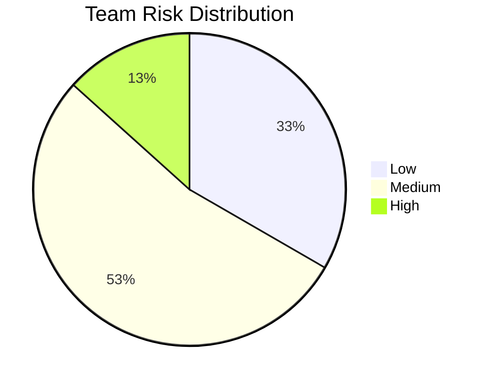
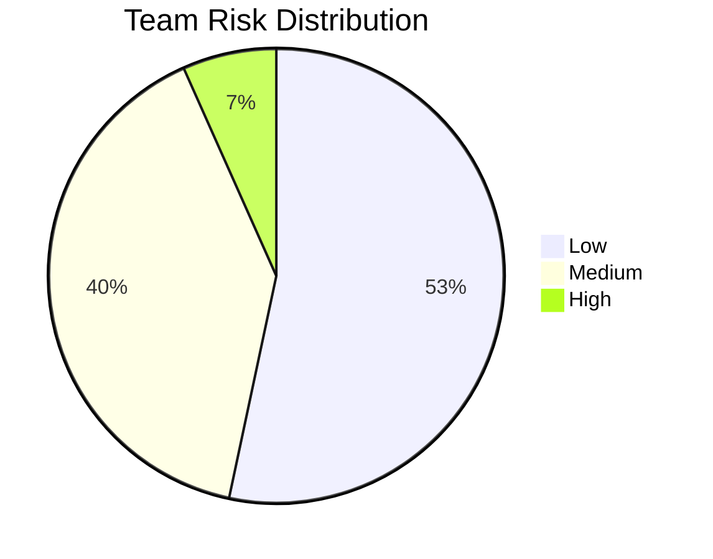
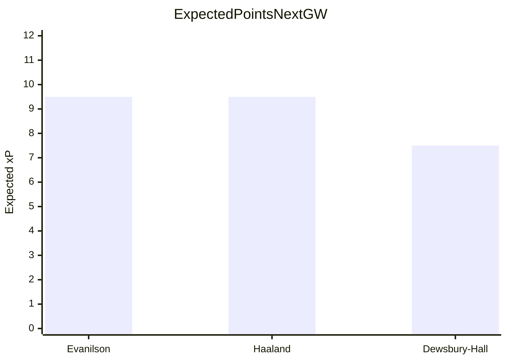
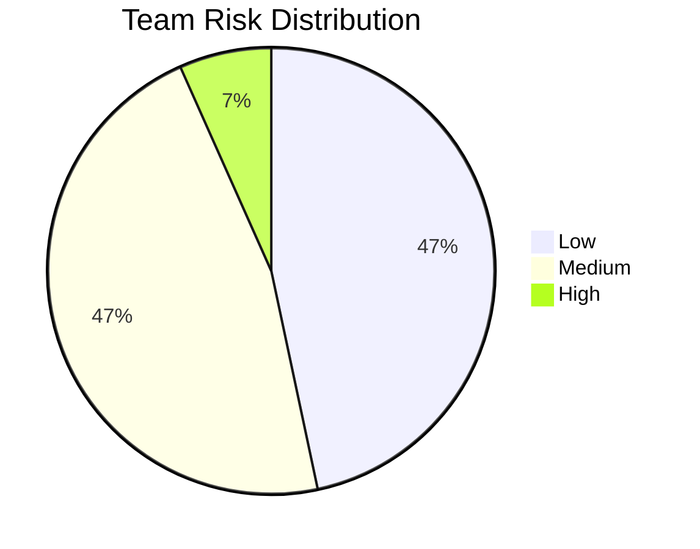

# FPL WEEKLY ANALYSIS REPORT
Generated: 2026-10-22 17:54:49

## Team Overview
| Team | Team ID | Value | Bank | Free transfers | Transfers used | Captain pick |
|------|---------|-------|------|----------------|----------------|--------------|
| Suresh's Invincibles | 7100718 | 100.4m | 1.0m | 0 | 1 | De Cuyper |
| Frogs FC | 7194103 | 100.1m | 0.0m | 1 | 0 | Haaland |
| ro$a parks the buss | 8176746 | 101.3m | 3.1m | 1 | 0 | Haaland |

---

# FPL WEEKLY ANALYSIS REPORT - Suresh's Invincibles
Generated: 2026-10-22 17:54:47
Manager: Suresh K
Team: Suresh's Invincibles
Team ID: 7100718

## Summary

| Team | Value | Bank | Free transfers | Transfers used | Captain pick |
|------|-------|------|----------------|----------------|--------------|
| Suresh's Invincibles | £100.4m | £1.0m | 0 | 1 | De Cuyper |

## Risk Snapshot



## Captaincy Comparison

```mermaid
xychart-beta
    title Expected Points Next GW
    x-axis [De Cuyper, Calafiori, João Pedro]
    y-axis "Expected xP" 0 --> 12
    bar [10.5, 7.5, 7.0]
```

## Risk Table

| Player | Pos | Form | xP | FDR | Risk | Cost |
|--------|-----|------|----|-----|------|------|
| Lecomte | GK | 0.0 ░░░░░░░░ | 0.0 | 3.2 | Medium | £4.0m |
| Saka | MID | 2.5 ██░░░░░░ | 1.2 | 3.2 | High | £9.6m |
| Semenyo | MID | 2.0 █░░░░░░░ | 0.0 | 3.2 | High | £8.3m |
| George | MID | 1.0 ░░░░░░░░ | 1.0 | 3.4 | Medium | £5.5m |
| Wissa | FWD | 1.5 █░░░░░░░ | 1.5 | 3.4 | Medium | £6.1m |
| B.Fernandes | MID | 1.0 ░░░░░░░░ | 1.0 | 3.4 | Medium | £11.8m |
| Pickford | GK | 1.5 █░░░░░░░ | 1.5 | 3.4 | Medium | £5.5m |
| Diop | DEF | 2.5 ██░░░░░░ | 2.5 | 2.8 | Medium | £3.9m |

## ⚠️ Players to Consider Transferring Out

### Lecomte (GK) - Fulham - £4.0m
- Poor form (0.0)
- Low expected points (0.0)
- Next 3 fixtures: Coventry City(A, FDR:2), Aston Villa(A, FDR:3), Newcastle(H, FDR:3)
- Free transfers available: 0
- Suggested move: Lecomte OUT -> Verbruggen IN
- Net cost: £0.6m
- Transfer hit if no free transfer: £0.6m
- Value score: 1.63 xP per £m
- Target reason: form 7.5, xP 7.5, fixtures Liverpool(A, FDR:4), Man City(A, FDR:5), Brentford(H, FDR:3)

| Out | In | Net cost | xP/£m | Notes |
|-----|----|----------|-------|-------|
| Lecomte | Verbruggen | £0.6m | 1.63 | Transfer hit applies |

---

### Saka (MID) - Arsenal - £9.6m
- **INJURED/UNAVAILABLE** - Thigh injury - 50% chance of playing
- Doubt for next match (50% chance)
- Poor form (2.5)
- Low expected points (1.2)
- Next 3 fixtures: Everton(H, FDR:3), Liverpool(A, FDR:4), Hull City(H, FDR:2)
- Free transfers available: 0
- Suggested move: Saka OUT -> Henderson IN
- Net cost: £-4.7m
- Transfer hit if no free transfer: £0.0m
- Value score: 2.14 xP per £m
- Target reason: form 10.5, xP 10.5, fixtures Spurs(H, FDR:2), Man Utd(H, FDR:4), Sunderland(A, FDR:3)

| Out | In | Net cost | xP/£m | Notes |
|-----|----|----------|-------|-------|
| Saka | Henderson | £-4.7m | 2.14 | Transfer hit applies |

---

### Semenyo (MID) - Man City - £8.3m
- **INJURED/UNAVAILABLE** - Knee injury - Unknown return date
- Poor form (2.0)
- Low expected points (0.0)
- Next 3 fixtures: Aston Villa(A, FDR:3), Brighton(H, FDR:3), Nott'm Forest(A, FDR:3)
- Free transfers available: 0
- Suggested move: Semenyo OUT -> Henderson IN
- Net cost: £-3.4m
- Transfer hit if no free transfer: £0.0m
- Value score: 2.14 xP per £m
- Target reason: form 10.5, xP 10.5, fixtures Spurs(H, FDR:2), Man Utd(H, FDR:4), Sunderland(A, FDR:3)

| Out | In | Net cost | xP/£m | Notes |
|-----|----|----------|-------|-------|
| Semenyo | Henderson | £-3.4m | 2.14 | Transfer hit applies |

---

### George (MID) - Everton - £5.5m
- Poor form (1.0)
- Low expected points (1.0)
- Next 3 fixtures: Arsenal(A, FDR:5), Newcastle(A, FDR:3), Coventry City(H, FDR:2)
- Free transfers available: 0
- Suggested move: George OUT -> Henderson IN
- Net cost: £-0.6m
- Transfer hit if no free transfer: £0.0m
- Value score: 2.14 xP per £m
- Target reason: form 10.5, xP 10.5, fixtures Spurs(H, FDR:2), Man Utd(H, FDR:4), Sunderland(A, FDR:3)

| Out | In | Net cost | xP/£m | Notes |
|-----|----|----------|-------|-------|
| George | Henderson | £-0.6m | 2.14 | Transfer hit applies |

---

### Wissa (FWD) - Newcastle - £6.1m
- Poor form (1.5)
- Low expected points (1.5)
- Next 3 fixtures: Crystal Palace(A, FDR:3), Everton(H, FDR:3), Fulham(A, FDR:3)
- Free transfers available: 0
- Suggested move: Wissa OUT -> Evanilson IN
- Net cost: £0.0m
- Transfer hit if no free transfer: £0.0m
- Value score: 1.56 xP per £m
- Target reason: form 9.5, xP 9.5, fixtures Man Utd(A, FDR:4), Leeds(H, FDR:3), Ipswich Town(A, FDR:2)

| Out | In | Net cost | xP/£m | Notes |
|-----|----|----------|-------|-------|
| Wissa | Evanilson | £0.0m | 1.56 | Transfer hit applies |

---

## 🌟 Top Performers

| Player | Pos | Team | Form | xP | Fixtures |
|--------|-----|------|------|----|----------|
| De Cuyper | DEF | Brighton | 10.5 | 10.5 | Liverpool(A, FDR:4), Man City(A, FDR:5), Brentford(H, FDR:3) |
| João Pedro | FWD | Chelsea | 7.0 | 7.0 | Spurs(H, FDR:2), Man Utd(H, FDR:4), Sunderland(A, FDR:3) |
| Calafiori | DEF | Arsenal | 7.5 | 7.5 | Everton(H, FDR:3), Liverpool(A, FDR:4), Hull City(H, FDR:2) |
| Kostoulas | FWD | Brighton | 6.5 | 6.5 | Liverpool(A, FDR:4), Man City(A, FDR:5), Brentford(H, FDR:3) |
| Palmer | MID | Chelsea | 5.0 | 5.0 | Spurs(H, FDR:2), Man Utd(H, FDR:4), Sunderland(A, FDR:3) |

## 👑 Captain Recommendations

1. **De Cuyper** - Expected: 10.5 points | Next fixture: Liverpool
2. **Calafiori** - Expected: 7.5 points | Next fixture: Everton
3. **João Pedro** - Expected: 7.0 points | Next fixture: Spurs

## Transfer Strategy

- No free transfers available this GW.
- Favor low-net-cost moves and only do transfers that materially improve xP or fixture difficulty.
- If the net cost is high, make sure the incoming player has stronger expected points and fixtures than the outgoing player.
# FPL WEEKLY ANALYSIS REPORT - Frogs FC
Generated: 2026-10-22 17:54:48
Manager: Sanvika Suresh
Team: Frogs FC
Team ID: 7194103

## Summary

| Team | Value | Bank | Free transfers | Transfers used | Captain pick |
|------|-------|------|----------------|----------------|--------------|
| Frogs FC | £100.1m | £0.0m | 1 | 0 | Evanilson |

## Risk Snapshot



## Captaincy Comparison



## Risk Table

| Player | Pos | Form | xP | FDR | Risk | Cost |
|--------|-----|------|----|-----|------|------|
| Fernandes | MID | 1.0 ░░░░░░░░ | 1.0 | 2.8 | Medium | £5.7m |
| Kayode | DEF | 0.5 ░░░░░░░░ | 0.5 | 3.2 | Medium | £4.6m |
| Martinez | GK | 5.5 ████░░░░ | 0.0 | 3.0 | High | £5.0m |
| Gibbs-White | MID | 1.0 ░░░░░░░░ | 1.0 | 3.2 | Medium | £7.9m |
| Diop | DEF | 2.5 ██░░░░░░ | 2.5 | 2.8 | Medium | £3.9m |
| Branthwaite | DEF | 2.0 █░░░░░░░ | 2.0 | 3.4 | Medium | £5.5m |
| Tzolakis | GK | 2.5 ██░░░░░░ | 2.5 | 3.2 | Medium | £4.7m |
| Castagne | DEF | 4.0 ███░░░░░ | 4.0 | 3.2 | Low | £4.5m |

## ⚠️ Players to Consider Transferring Out

### Fernandes (MID) - Spurs - £5.7m
- Poor form (1.0)
- Low expected points (1.0)
- Next 3 fixtures: Chelsea(A, FDR:4), Crystal Palace(H, FDR:2), Leeds(A, FDR:3)
- Free transfers available: 1
- Suggested move: Fernandes OUT -> Henderson IN
- Net cost: £-0.8m
- Transfer hit if no free transfer: £0.0m
- Value score: 2.14 xP per £m
- Target reason: form 10.5, xP 10.5, fixtures Spurs(H, FDR:2), Man Utd(H, FDR:4), Sunderland(A, FDR:3)

| Out | In | Net cost | xP/£m | Notes |
|-----|----|----------|-------|-------|
| Fernandes | Henderson | £-0.8m | 2.14 | Free transfer available |

---

### Kayode (DEF) - Brentford - £4.6m
- Poor form (0.5)
- Low expected points (0.5)
- Next 3 fixtures: Hull City(A, FDR:2), Nott'm Forest(H, FDR:3), Brighton(A, FDR:4)
- Free transfers available: 1
- Suggested move: Kayode OUT -> F.Kadıoğlu IN
- Net cost: £-0.2m
- Transfer hit if no free transfer: £0.0m
- Value score: 1.70 xP per £m
- Target reason: form 7.5, xP 7.5, fixtures Liverpool(A, FDR:4), Man City(A, FDR:5), Brentford(H, FDR:3)

| Out | In | Net cost | xP/£m | Notes |
|-----|----|----------|-------|-------|
| Kayode | F.Kadıoğlu | £-0.2m | 1.70 | Free transfer available |

---

### Martinez (GK) - Chelsea - £5.0m
- **INJURED/UNAVAILABLE** - Head injury - Unknown return date
- Low expected points (0.0)
- Next 3 fixtures: Spurs(H, FDR:2), Man Utd(H, FDR:4), Sunderland(A, FDR:3)
- Free transfers available: 1
- Suggested move: Martinez OUT -> Verbruggen IN
- Net cost: £-0.4m
- Transfer hit if no free transfer: £0.0m
- Value score: 1.63 xP per £m
- Target reason: form 7.5, xP 7.5, fixtures Liverpool(A, FDR:4), Man City(A, FDR:5), Brentford(H, FDR:3)

| Out | In | Net cost | xP/£m | Notes |
|-----|----|----------|-------|-------|
| Martinez | Verbruggen | £-0.4m | 1.63 | Free transfer available |

---

### Gibbs-White (MID) - Nott'm Forest - £7.9m
- Poor form (1.0)
- Low expected points (1.0)
- Next 3 fixtures: Ipswich Town(A, FDR:2), Brentford(A, FDR:3), Man City(H, FDR:4)
- Free transfers available: 1
- Suggested move: Gibbs-White OUT -> Henderson IN
- Net cost: £-3.0m
- Transfer hit if no free transfer: £0.0m
- Value score: 2.14 xP per £m
- Target reason: form 10.5, xP 10.5, fixtures Spurs(H, FDR:2), Man Utd(H, FDR:4), Sunderland(A, FDR:3)

| Out | In | Net cost | xP/£m | Notes |
|-----|----|----------|-------|-------|
| Gibbs-White | Henderson | £-3.0m | 2.14 | Free transfer available |

---

### Diop (DEF) - Ipswich Town - £3.9m
- Poor form (2.5)
- Next 3 fixtures: Nott'm Forest(H, FDR:3), Hull City(A, FDR:2), Bournemouth(H, FDR:3)
- Free transfers available: 1
- Suggested move: Diop OUT -> Davies IN
- Net cost: £0.0m
- Transfer hit if no free transfer: £0.0m
- Value score: 0.90 xP per £m
- Target reason: form 3.5, xP 3.5, fixtures Chelsea(A, FDR:4), Crystal Palace(H, FDR:2), Leeds(A, FDR:3)

| Out | In | Net cost | xP/£m | Notes |
|-----|----|----------|-------|-------|
| Diop | Davies | £0.0m | 0.90 | Free transfer available |

---

## 🌟 Top Performers

| Player | Pos | Team | Form | xP | Fixtures |
|--------|-----|------|------|----|----------|
| Haaland | FWD | Man City | 9.5 | 9.5 | Aston Villa(A, FDR:3), Brighton(H, FDR:3), Nott'm Forest(A, FDR:3) |
| Evanilson | FWD | Bournemouth | 9.5 | 9.5 | Man Utd(A, FDR:4), Leeds(H, FDR:3), Ipswich Town(A, FDR:2) |
| Dewsbury-Hall | MID | Everton | 7.5 | 7.5 | Arsenal(A, FDR:5), Newcastle(A, FDR:3), Coventry City(H, FDR:2) |
| Rogers | MID | Chelsea | 5.5 | 5.5 | Spurs(H, FDR:2), Man Utd(H, FDR:4), Sunderland(A, FDR:3) |
| Cunha | MID | Man Utd | 5.5 | 5.5 | Bournemouth(H, FDR:3), Chelsea(A, FDR:4), Aston Villa(H, FDR:3) |

## 👑 Captain Recommendations

1. **Evanilson** - Expected: 9.5 points | Next fixture: Man Utd
2. **Haaland** - Expected: 9.5 points | Next fixture: Aston Villa
3. **Dewsbury-Hall** - Expected: 7.5 points | Next fixture: Arsenal

## Best Single Transfer

- OUT: Fernandes (MID)
- IN: Henderson (MID)
- Net cost: £-0.8m
- Estimated transfer hit: £0.0m
- Value score: 2.14 xP per £m
- Reason: best low-risk, high-value move under your current transfer constraints

## Transfer Strategy

- You have 1 free transfer(s) available this GW.
- Prioritize moves that improve xP without a transfer hit or with a small net cost.
- If a player has poor fixtures or poor form, the best move is often a cheaper, higher-xP alternative in the same position.
# FPL WEEKLY ANALYSIS REPORT - ro$a parks the buss
Generated: 2026-10-22 17:54:49
Manager: Mikhail Leo
Team: ro$a parks the buss
Team ID: 8176746

## Summary

| Team | Value | Bank | Free transfers | Transfers used | Captain pick |
|------|-------|------|----------------|----------------|--------------|
| ro$a parks the buss | £101.3m | £3.1m | 1 | 0 | Haaland |

## Risk Snapshot



## Captaincy Comparison

```mermaid
xychart-beta
    title Expected Points Next GW
    x-axis [Haaland, João Pedro, Groß]
    y-axis "Expected xP" 0 --> 12
    bar [9.5, 7.0, 5.5]
```

## Risk Table

| Player | Pos | Form | xP | FDR | Risk | Cost |
|--------|-----|------|----|-----|------|------|
| Dubravka | GK | 0.0 ░░░░░░░░ | 0.0 | 2.8 | Medium | £4.0m |
| Szoboszlai | MID | 0.5 ░░░░░░░░ | 0.0 | 3.4 | High | £6.8m |
| Walle Egeli | FWD | 0.5 ░░░░░░░░ | 0.5 | 2.8 | Medium | £4.5m |
| M.Sangaré | MID | 1.0 ░░░░░░░░ | 1.0 | 3.2 | Medium | £5.5m |
| Kelleher | GK | 2.0 █░░░░░░░ | 2.0 | 3.2 | Medium | £5.0m |
| Hall | DEF | 2.0 █░░░░░░░ | 2.0 | 3.4 | Medium | £5.3m |
| Egan | DEF | 2.5 ██░░░░░░ | 2.5 | 3.2 | Medium | £4.1m |
| Gvardiol | DEF | 2.0 █░░░░░░░ | 2.0 | 3.2 | Medium | £5.8m |

## ⚠️ Players to Consider Transferring Out

### Dubravka (GK) - Spurs - £4.0m
- Poor form (0.0)
- Low expected points (0.0)
- Next 3 fixtures: Chelsea(A, FDR:4), Crystal Palace(H, FDR:2), Leeds(A, FDR:3)
- Free transfers available: 1
- Suggested move: Dubravka OUT -> Verbruggen IN
- Net cost: £0.6m
- Transfer hit if no free transfer: £0.0m
- Value score: 1.63 xP per £m
- Target reason: form 7.5, xP 7.5, fixtures Liverpool(A, FDR:4), Man City(A, FDR:5), Brentford(H, FDR:3)

| Out | In | Net cost | xP/£m | Notes |
|-----|----|----------|-------|-------|
| Dubravka | Verbruggen | £0.6m | 1.63 | Free transfer available |

---

### Szoboszlai (MID) - Liverpool - £6.8m
- **INJURED/UNAVAILABLE** - Hamstring injury - Unknown return date
- Poor form (0.5)
- Low expected points (0.0)
- Next 3 fixtures: Brighton(H, FDR:3), Arsenal(H, FDR:4), Crystal Palace(A, FDR:3)
- Free transfers available: 1
- Suggested move: Szoboszlai OUT -> Henderson IN
- Net cost: £-1.9m
- Transfer hit if no free transfer: £0.0m
- Value score: 2.14 xP per £m
- Target reason: form 10.5, xP 10.5, fixtures Spurs(H, FDR:2), Man Utd(H, FDR:4), Sunderland(A, FDR:3)

| Out | In | Net cost | xP/£m | Notes |
|-----|----|----------|-------|-------|
| Szoboszlai | Henderson | £-1.9m | 2.14 | Free transfer available |

---

### Walle Egeli (FWD) - Ipswich Town - £4.5m
- Poor form (0.5)
- Low expected points (0.5)
- Next 3 fixtures: Nott'm Forest(H, FDR:3), Hull City(A, FDR:2), Bournemouth(H, FDR:3)
- Free transfers available: 1
- Suggested move: Walle Egeli OUT -> Evanilson IN
- Net cost: £1.6m
- Transfer hit if no free transfer: £0.0m
- Value score: 1.56 xP per £m
- Target reason: form 9.5, xP 9.5, fixtures Man Utd(A, FDR:4), Leeds(H, FDR:3), Ipswich Town(A, FDR:2)

| Out | In | Net cost | xP/£m | Notes |
|-----|----|----------|-------|-------|
| Walle Egeli | Evanilson | £1.6m | 1.56 | Free transfer available |

---

### M.Sangaré (MID) - Brentford - £5.5m
- Poor form (1.0)
- Low expected points (1.0)
- Next 3 fixtures: Hull City(A, FDR:2), Nott'm Forest(H, FDR:3), Brighton(A, FDR:4)
- Free transfers available: 1
- Suggested move: M.Sangaré OUT -> Henderson IN
- Net cost: £-0.6m
- Transfer hit if no free transfer: £0.0m
- Value score: 2.14 xP per £m
- Target reason: form 10.5, xP 10.5, fixtures Spurs(H, FDR:2), Man Utd(H, FDR:4), Sunderland(A, FDR:3)

| Out | In | Net cost | xP/£m | Notes |
|-----|----|----------|-------|-------|
| M.Sangaré | Henderson | £-0.6m | 2.14 | Free transfer available |

---

### Kelleher (GK) - Brentford - £5.0m
- Poor form (2.0)
- Next 3 fixtures: Hull City(A, FDR:2), Nott'm Forest(H, FDR:3), Brighton(A, FDR:4)
- Free transfers available: 1
- Suggested move: Kelleher OUT -> Verbruggen IN
- Net cost: £-0.4m
- Transfer hit if no free transfer: £0.0m
- Value score: 1.63 xP per £m
- Target reason: form 7.5, xP 7.5, fixtures Liverpool(A, FDR:4), Man City(A, FDR:5), Brentford(H, FDR:3)

| Out | In | Net cost | xP/£m | Notes |
|-----|----|----------|-------|-------|
| Kelleher | Verbruggen | £-0.4m | 1.63 | Free transfer available |

---

## 🌟 Top Performers

| Player | Pos | Team | Form | xP | Fixtures |
|--------|-----|------|------|----|----------|
| Haaland | FWD | Man City | 9.5 | 9.5 | Aston Villa(A, FDR:3), Brighton(H, FDR:3), Nott'm Forest(A, FDR:3) |
| João Pedro | FWD | Chelsea | 7.0 | 7.0 | Spurs(H, FDR:2), Man Utd(H, FDR:4), Sunderland(A, FDR:3) |
| Groß | MID | Brighton | 5.5 | 5.5 | Liverpool(A, FDR:4), Man City(A, FDR:5), Brentford(H, FDR:3) |
| Cherki | MID | Man City | 5.0 | 5.0 | Aston Villa(A, FDR:3), Brighton(H, FDR:3), Nott'm Forest(A, FDR:3) |
| Palmer | MID | Chelsea | 5.0 | 5.0 | Spurs(H, FDR:2), Man Utd(H, FDR:4), Sunderland(A, FDR:3) |

## 👑 Captain Recommendations

1. **Haaland** - Expected: 9.5 points | Next fixture: Aston Villa
2. **João Pedro** - Expected: 7.0 points | Next fixture: Spurs
3. **Groß** - Expected: 5.5 points | Next fixture: Liverpool

## Best Single Transfer

- OUT: Szoboszlai (MID)
- IN: Henderson (MID)
- Net cost: £-1.9m
- Estimated transfer hit: £0.0m
- Value score: 2.14 xP per £m
- Reason: best low-risk, high-value move under your current transfer constraints

## Transfer Strategy

- You have 1 free transfer(s) available this GW.
- Prioritize moves that improve xP without a transfer hit or with a small net cost.
- If a player has poor fixtures or poor form, the best move is often a cheaper, higher-xP alternative in the same position.